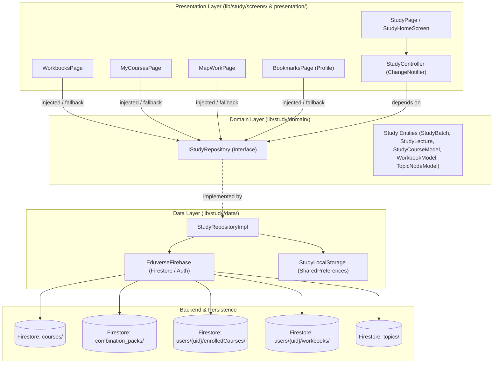

# Phase 03: Architecture Consolidation & Repository Migration - Research

**Researched:** 2026-09-20
**Domain:** Flutter / Dart Clean Architecture, Repository Pattern, Dependency Injection (Provider), Firestore Data Modeling
**Confidence:** HIGH

<user_constraints>
## User Constraints (from CONTEXT.md)

No user constraints - all decisions at the agent's discretion. (No CONTEXT.md existed prior to planning Phase 3).

### Locked Decisions (from ROADMAP.md & REQUIREMENTS.md)
- **ENH-02**: Unified Study Repository migration: deprecate legacy `StudyRepository` and route all screens to `StudyRepositoryImpl`.
- **Success Criteria 1**: `lib/study/screens/workbooks_page.dart` and `my_courses_page.dart` use `StudyRepositoryImpl` or inject `IStudyRepository`.
- **Success Criteria 2**: Combination pack course resolutions work consistently across all study subviews.
- **Success Criteria 3**: Legacy `lib/study/study_repository.dart` is safely deprecated and removed.
- **Success Criteria 4**: All existing study unit and widget tests pass without regressions.

### The Agent's Discretion
- Interface expansion: adding missing methods (`getWorkbooks`, `getEnrolledCourses`, `getTopics`) to `IStudyRepository` to allow complete decoupled dependency injection across all callers.
- Two-plan execution strategy: Plan 03-01 migrates all callers to `IStudyRepository` / `StudyRepositoryImpl` and installs a `@Deprecated` facade; Plan 03-02 deletes `study_repository.dart`, adds new unit and widget tests, and runs full regression validation.
- Constructor injection with default fallback vs Provider lookup in widgets.
</user_constraints>

<architectural_responsibility_map>
## Architectural Responsibility Map

| Capability | Primary Tier | Secondary Tier | Rationale |
|------------|-------------|----------------|-----------|
| Study Domain Contracts (`IStudyRepository`) | Client Domain Tier (`lib/study/domain/`) | — | Pure business contract declaring entities and streams without Firestore dependencies |
| Modern Study Repository (`StudyRepositoryImpl`) | Client Data Tier (`lib/study/data/`) | Cloud Firestore | Concrete implementation querying Firestore collections (`courses`, `users`, `combination_packs`, `workbooks`, `topics`) using `EduverseFirebase` |
| Study Presentation State (`StudyController`) | Client Presentation Tier (`lib/study/presentation/providers/`) | — | `ChangeNotifier` consuming `IStudyRepository` to expose reactive streams and selected room state to UI |
| Study Subviews (`workbooks_page.dart`, `my_courses_page.dart`, `map_work_page.dart`) | Client Presentation Tier (`lib/study/screens/`) | — | Flutter UI screens rendering study content, accepting optional `IStudyRepository` injection with fallback |
| Profile Bookmarks Integration (`bookmarks_page.dart`) | Client Presentation Tier (`lib/profile/screens/`) | Client Data Tier | Cross-module caller querying study batch metadata via repository abstraction |
| Legacy Facade (`lib/study/study_repository.dart`) | Client Compatibility Tier (Transitional) | — | Temporary deprecated alias ensuring zero breaking changes during intermediate migrations |
</architectural_responsibility_map>

<research_summary>
## Summary

A comprehensive investigation into the Eduverse codebase reveals dual study repository implementations: the legacy `lib/study/study_repository.dart` (852 lines) located directly in the feature root, and the modern `lib/study/data/repositories/study_repository_impl.dart` (975 lines) adhering to Clean Architecture domain/data tier separation. The legacy implementation bypasses the app's `EduverseFirebase` mock harness by binding directly to `FirebaseFirestore.instance` and `FirebaseAuth.instance`, completely lacks combination pack course resolution, and duplicates ~90% of the modern implementation.

Only four production files currently import or instantiate the legacy `StudyRepository`:
1. `lib/study/screens/workbooks_page.dart` (calls `getWorkbooks()`)
2. `lib/study/screens/my_courses_page.dart` (calls `getEnrolledCourses()`)
3. `lib/study/screens/map_work_page.dart` (calls `getTopics()`)
4. `lib/profile/screens/bookmarks_page.dart` (calls `getBatch()`)

Crucially, while `StudyRepositoryImpl` already implements `getWorkbooks()`, `getEnrolledCourses()`, and `getTopics()`, these three methods were omitted from the domain contract `IStudyRepository` (`lib/study/domain/repositories/i_study_repository.dart`). Adding these signatures to `IStudyRepository` enables complete, type-safe constructor injection in `WorkbooksPage`, `MyCoursesPage`, and `MapWorkPage` with a seamless default of `StudyRepositoryImpl()`. Furthermore, enhancing `StudyRepositoryImpl.getEnrolledCourses()` to resolve bundled courses from `combination_packs` guarantees that students who purchase combo packs see all courses reflected across all study subviews without regressions.

**Primary recommendation:** Expand `IStudyRepository` to include `getWorkbooks()`, `getEnrolledCourses()`, and `getTopics()`; update test fakes (`FakeStudyRepository`, `MockStudyRepository`); migrate the 4 callers (`workbooks_page.dart`, `my_courses_page.dart`, `map_work_page.dart`, `bookmarks_page.dart`) to injected `IStudyRepository` defaulting to `StudyRepositoryImpl()`; deprecate and permanently remove `lib/study/study_repository.dart`; and verify using automated unit, widget, and E2E suites.
</research_summary>

<standard_stack>
## Standard Stack

### Core
| Library | Version | Purpose | Why Standard |
|---------|---------|---------|--------------|
| flutter | 3.32+ (Dart 3.8+) | UI Framework | Project foundational framework |
| provider | ^6.1.2 | State & Dependency Injection | App standard for injecting controllers and repositories (`ChangeNotifierProvider`, `Provider.of`) |
| cloud_firestore | ^5.6.5 | Document Database SDK | Firestore streaming and querying |
| firebase_auth | ^5.5.1 | User Authentication | Accessing current user session UID |
| flutter_test | SDK | Unit & Widget Testing | Flutter automated testing framework |

### Supporting
| Library | Version | Purpose | When to Use |
|---------|---------|---------|-------------|
| eduverse/core/firebase/eduverse_firebase.dart | Internal | Mockable Firebase Wrapper | Mandatory replacement for direct `FirebaseFirestore.instance` and `FirebaseAuth.instance` |
| eduverse/study/domain/repositories/i_study_repository.dart | Internal | Domain Contract Interface | The sole abstraction widgets and controllers should depend upon |
| shared_preferences | ^2.3.5 | Local Storage Cache | Caching bookmarks and batch selections |
| hive / hive_flutter | ^2.2.3 | Fast Key-Value Storage | Local lecture progress caching |

### Alternatives Considered
| Instead of | Could Use | Tradeoff |
|------------|-----------|----------|
| Constructor injection with default fallback (`repository ?? StudyRepositoryImpl()`) | Pure Provider lookup (`Provider.of<IStudyRepository>(context)`) | Pure Provider lookup requires every route push (including from Profile, deep links, or test scaffolds) to provide `IStudyRepository`. Constructor injection with default fallback guarantees standalone screen instantiability while remaining 100% testable via mocks. |
| One-step hard delete of `study_repository.dart` | Two-phase deprecation (facade in Plan 1, deletion in Plan 2) | Two-phase deprecation eliminates risk of broken intermediate builds across multi-step execution. |
| Separate `WorkbookRepository` | Retaining `getWorkbooks()` in `IStudyRepository` | Splitting into micro-repositories would require touching multiple architectural layers unnecessarily; keeping workbooks within `IStudyRepository` matches existing data models and `StudyRepositoryImpl`. |

</standard_stack>

<architecture_patterns>
## Architecture Patterns

### System Architecture Diagram



### Recommended Project Structure
```
lib/study/
├── domain/
│   ├── models/
│   │   ├── study_entities.dart         # StudyBatch, StudyLecture, StudyQuiz, etc.
│   │   └── test_series_entities.dart
│   └── repositories/
│       └── i_study_repository.dart     # Single domain contract for all study data access
├── data/
│   └── repositories/
│       ├── study_repository_impl.dart  # Concrete implementation querying EduverseFirebase
│       ├── study_local_storage.dart    # SharedPreferences cache
│       ├── lecture_progress_repository.dart
│       └── community_repository.dart
├── presentation/
│   ├── providers/
│   │   └── study_controller.dart       # State management for study rooms and tabs
│   ├── screens/                        # Modular modern study screens
│   └── widgets/                        # Modular study widgets
├── screens/                            # Legacy/standalone screens (workbooks, my_courses, map_work)
│   ├── workbooks_page.dart             # Migrated to IStudyRepository
│   ├── my_courses_page.dart            # Migrated to IStudyRepository
│   └── map_work_page.dart              # Migrated to IStudyRepository
└── study_repository.dart               # [TO BE REMOVED] Legacy duplicate file
```

### Pattern 1: Domain-Data Layered Architecture (Dependency Inversion)
**What:** Presentation components depend exclusively on `IStudyRepository` from the domain layer. All concrete Firebase queries and data transformations live in `StudyRepositoryImpl` in the data layer.
**When to use:** Everywhere study data is fetched or updated.
**Example:**
```dart
// lib/study/domain/repositories/i_study_repository.dart
abstract class IStudyRepository {
  Stream<List<StudyBatch>> getEnrolledBatches(String userId);
  Stream<List<WorkbookModel>> getWorkbooks();
  Stream<List<StudyCourseModel>> getEnrolledCourses();
  Stream<List<TopicNodeModel>> getTopics();
  Future<StudyBatch?> getBatch(String batchId, {required String courseId});
  // ... remaining 14 methods
}
```

### Pattern 2: Constructor Dependency Injection with Default Fallback
**What:** Screen widgets accept an optional `IStudyRepository? repository` in the constructor. In `initState` or `build`, if null, it falls back to `StudyRepositoryImpl()`.
**When to use:** In `WorkbooksPage`, `MyCoursesPage`, `MapWorkPage`, and `BookmarksPage`.
**Why:** Guarantees that existing push routes (e.g. `Navigator.push(context, MaterialPageRoute(builder: (_) => const WorkbooksPage()))`) continue working without requiring an ancestor `Provider<IStudyRepository>`, while enabling widget unit tests to inject mock repositories instantly.
**Example:**
```dart
class WorkbooksPage extends StatefulWidget {
  final IStudyRepository? repository;
  const WorkbooksPage({super.key, this.repository});

  @override
  State<WorkbooksPage> createState() => _WorkbooksPageState();
}

class _WorkbooksPageState extends State<WorkbooksPage> {
  late final IStudyRepository _repository;

  @override
  void initState() {
    super.initState();
    _repository = widget.repository ?? StudyRepositoryImpl();
  }
  // ...
}
```

### Pattern 3: Combination Pack Course Resolution
**What:** In `StudyRepositoryImpl`, combination packs are unbundled so both the bundle container (`isCombo: true`) and all child courses (`isCombo: false`) are represented in batch lists and course lists.
**When to use:** When processing `enrolledCourses` snapshots from Firestore.
**Resolution Flow:**
1. Check `users/{userId}/enrolledCourses` documents.
2. If `combinationPackId` is present:
   - Query `combination_packs/{comboId}`.
   - Extract bundled course IDs from `comboData['courses']` (or legacy `comboData['batches']`).
   - For each child course, query `courses/{courseId}` and `courseProgress/{courseId}`.
   - Add each child course as an individual course.
   - Aggregate progress across child courses and create a combo container batch (`isCombo: true, courseIds: [...]`).
3. For individual course enrollments:
   - Query `courses/{courseId}` and progress directly.
4. Deduplicate by `courseId` so courses bundled in combos don't appear twice if also enrolled individually.

### Anti-Patterns to Avoid
- **Direct Concrete Instantiation (`StudyRepository()`):** Violates Clean Architecture and breaks mockability.
- **Direct Global Firebase Access (`FirebaseFirestore.instance`):** Bypasses `EduverseFirebase.firestore` and prevents `FakeFirebaseFirestore` from functioning in automated test suites.
- **Repository Duplication in Feature Roots:** Keeping `lib/study/study_repository.dart` alongside `lib/study/data/repositories/study_repository_impl.dart` leads to confusion about which repository contains up-to-date logic.
- **Missing Interface Signatures:** Implementing methods on `StudyRepositoryImpl` without declaring them in `IStudyRepository` forces clients to cast or depend directly on the implementation class.
</architecture_patterns>

<dont_hand_roll>
## Don't Hand-Roll

| Problem | Don't Build | Use Instead | Why |
|---------|-------------|-------------|-----|
| Mocking Firebase in tests | Custom mock classes with complex stubbing | `FakeFirebaseFirestore` & `EduverseFirebase.mockFirestore` | Eduverse already has a battle-tested in-memory Fake Firebase harness (`test/e2e/harness/fake_firebase_firestore.dart`) used across 90+ tests. |
| Navigation-level dependency wiring | Complex custom ServiceLocator | Constructor injection + Provider lookup | Idiomatic Flutter pattern; minimizes boilerplate and avoids service locator anti-patterns. |
| Progress aggregation math | Ad-hoc progress calculation per screen | `StudyRepositoryImpl._fetchCourseProgress` & centralized calculation | Ensures identical completed lecture counts and percentages across Home, Batch Detail, My Courses, and Profile. |

**Key insight:** Both the clean repository implementation (`StudyRepositoryImpl`) and the in-memory test harness (`EduverseFirebase.mockFirestore`) already exist and are proven. The problem in Phase 3 is not authoring new infrastructure, but standardizing callsites onto the existing modern contracts and retiring dead legacy code.
</dont_hand_roll>

<common_pitfalls>
## Common Pitfalls

### Pitfall 1: Breaking Test Mocks by Updating `IStudyRepository`
**What goes wrong:** Adding `getWorkbooks()`, `getEnrolledCourses()`, or `getTopics()` to `IStudyRepository` causes compile-time errors in `FakeStudyRepository` (`test/widget/live_classes_section_test.dart`) and `MockStudyRepository` (`test/e2e/pdf_viewer_e2e_test.dart`) because they implement `IStudyRepository`.
**Why it happens:** In Dart, classes implementing an interface must implement all declared methods or be abstract.
**How to avoid:** In Plan 03-01, simultaneously add the method stubs with sensible default returns (`Stream.value([])`) to `FakeStudyRepository` and `MockStudyRepository`.
**Warning signs:** `Missing concrete implementation of 'IStudyRepository.getWorkbooks'` errors during `flutter test`.

### Pitfall 2: Combination Pack Asymmetry in `getEnrolledCourses()`
**What goes wrong:** A student purchases a combo pack (e.g. `Full Stack Mastery Bundle`), sees the combo and child courses in `StudyHomeScreen` (`getEnrolledBatches`), but navigates to `MyCoursesPage` (`getEnrolledCourses`) and finds it empty.
**Why it happens:** `StudyRepositoryImpl.getEnrolledBatches()` has rich combo-pack resolution logic, but `getEnrolledCourses()` originally only looked for `data['courseId'] ?? doc.id.split('_')[0]`. If the purchase doc has `combinationPackId` without expanding, `getEnrolledCourses` could miss child courses.
**How to avoid:** Align `StudyRepositoryImpl.getEnrolledCourses()` to resolve bundled courses from `combination_packs` just like `getEnrolledBatches()` does.
**Warning signs:** Discrepancy between the number of courses listed on the Study tab vs My Courses page.

### Pitfall 3: Direct `FirebaseAuth.instance` Usage in `getEnrolledCourses()` and `getWorkbooks()`
**What goes wrong:** Tests fail when running `my_courses_page_test` or `workbooks_page_test` with `Null check operator used on a null value` or uninitialized Firebase app.
**Why it happens:** In `StudyRepositoryImpl`, lines 699 and 763 use `EduverseFirebase.auth.currentUser?.uid`. If a test uses `StudyRepositoryImpl` with `EduverseFirebase.mockAuth` not set or `currentUser` null, it returns an empty stream instead of throwing, but if legacy code used `FirebaseAuth.instance`, it crashes without native Firebase initialization.
**How to avoid:** Ensure all callsites strictly use `EduverseFirebase.firestore` and `EduverseFirebase.auth`.
**Warning signs:** `[core/no-app] No Firebase App '[DEFAULT]' has been created` error during tests.

### Pitfall 4: Broken Imports Upon Deleting `study_repository.dart`
**What goes wrong:** Deleting `lib/study/study_repository.dart` causes compilation failures in unexpected files.
**Why it happens:** Hidden or indirect imports that weren't caught prior to deletion.
**How to avoid:** Grep has confirmed exactly four files import `study_repository.dart`:
- `lib/study/screens/workbooks_page.dart`
- `lib/study/screens/my_courses_page.dart`
- `lib/study/screens/map_work_page.dart`
- `lib/profile/screens/bookmarks_page.dart`
Migrate all four in Plan 03-01, verify with `flutter analyze lib/`, and only delete the file in Plan 03-02.
</common_pitfalls>

<code_examples>
## Code Examples

### 1. Expanding `IStudyRepository` Contract
```dart
// lib/study/domain/repositories/i_study_repository.dart
import 'package:eduverse/study/domain/models/study_entities.dart';
import 'package:eduverse/study/models/study_models.dart';

abstract class IStudyRepository {
  /// Stream of batches the user is enrolled in, including progress.
  Stream<List<StudyBatch>> getEnrolledBatches(String userId);

  /// Stream of workbooks assigned to the current user.
  Stream<List<WorkbookModel>> getWorkbooks();

  /// Stream of enrolled courses for the current user.
  Stream<List<StudyCourseModel>> getEnrolledCourses();

  /// Stream of topic nodes for topic map view.
  Stream<List<TopicNodeModel>> getTopics();

  // ... (all existing 18 methods unchanged)
}
```

### 2. Updating Test Fakes (`FakeStudyRepository` & `MockStudyRepository`)
```dart
// test/widget/live_classes_section_test.dart & test/e2e/pdf_viewer_e2e_test.dart
@override
Stream<List<WorkbookModel>> getWorkbooks() => Stream.value([]);

@override
Stream<List<StudyCourseModel>> getEnrolledCourses() => Stream.value([]);

@override
Stream<List<TopicNodeModel>> getTopics() => Stream.value([]);
```

### 3. Migrating `WorkbooksPage` to `IStudyRepository`
```dart
// lib/study/screens/workbooks_page.dart
import 'package:flutter/material.dart';
import 'package:intl/intl.dart';
import 'package:eduverse/study/domain/repositories/i_study_repository.dart';
import 'package:eduverse/study/data/repositories/study_repository_impl.dart';
import 'package:eduverse/study/models/study_models.dart';

class WorkbooksPage extends StatefulWidget {
  final IStudyRepository? repository;
  const WorkbooksPage({super.key, this.repository});

  @override
  State<WorkbooksPage> createState() => _WorkbooksPageState();
}

class _WorkbooksPageState extends State<WorkbooksPage> {
  String _selectedFilter = 'All';
  late final IStudyRepository _repository;

  @override
  void initState() {
    super.initState();
    _repository = widget.repository ?? StudyRepositoryImpl();
  }

  @override
  Widget build(BuildContext context) {
    return Scaffold(
      appBar: AppBar(title: const Text('Workbooks')),
      body: SafeArea(
        child: Column(
          children: [
            // filter chips...
            Expanded(
              child: StreamBuilder<List<WorkbookModel>>(
                stream: _repository.getWorkbooks(),
                builder: (context, snapshot) {
                  // ... rendering logic unchanged
                },
              ),
            ),
          ],
        ),
      ),
    );
  }
}
```

### 4. Migrating `MyCoursesPage` with Injected `IStudyRepository`
```dart
// lib/study/screens/my_courses_page.dart
import 'package:flutter/material.dart';
import 'package:eduverse/study/domain/repositories/i_study_repository.dart';
import 'package:eduverse/study/data/repositories/study_repository_impl.dart';
import 'package:eduverse/study/models/study_models.dart';
import 'course_section_page.dart';

class MyCoursesPage extends StatelessWidget {
  final IStudyRepository? repository;
  const MyCoursesPage({super.key, this.repository});

  @override
  Widget build(BuildContext context) {
    final repo = repository ?? StudyRepositoryImpl();

    return Scaffold(
      backgroundColor: Colors.grey[50],
      appBar: AppBar(title: const Text('My Courses')),
      body: SafeArea(
        child: Column(
          children: [
            // search field...
            Expanded(
              child: StreamBuilder<List<StudyCourseModel>>(
                stream: repo.getEnrolledCourses(),
                builder: (context, snapshot) {
                  // ... grid builder unchanged
                },
              ),
            ),
          ],
        ),
      ),
    );
  }
}
```

### 5. Migrating `MapWorkPage` and `BookmarksPage`
```dart
// lib/study/screens/map_work_page.dart
import 'package:flutter/material.dart';
import 'package:eduverse/study/domain/repositories/i_study_repository.dart';
import 'package:eduverse/study/data/repositories/study_repository_impl.dart';
import 'package:eduverse/study/models/study_models.dart';

class MapWorkPage extends StatelessWidget {
  final IStudyRepository? repository;
  const MapWorkPage({super.key, this.repository});

  @override
  Widget build(BuildContext context) {
    final repo = repository ?? StudyRepositoryImpl();
    return Scaffold(
      appBar: AppBar(title: const Text('Topic Map')),
      body: SafeArea(
        child: StreamBuilder<List<TopicNodeModel>>(
          stream: repo.getTopics(),
          builder: (context, snapshot) { ... },
        ),
      ),
    );
  }
}
```

```dart
// lib/profile/screens/bookmarks_page.dart
import 'package:eduverse/study/domain/repositories/i_study_repository.dart';
import 'package:eduverse/study/data/repositories/study_repository_impl.dart';

class BookmarksPage extends StatefulWidget {
  final IStudyRepository? studyRepository;
  const BookmarksPage({super.key, this.studyRepository});
  // ...
}

class _BookmarksPageState extends State<BookmarksPage> {
  late final IStudyRepository _studyRepository;

  @override
  void initState() {
    super.initState();
    _studyRepository = widget.studyRepository ?? StudyRepositoryImpl();
  }
  // ...
}
```

### 6. Deprecation Facade in `lib/study/study_repository.dart` (Transitional)
```dart
// lib/study/study_repository.dart
import 'package:eduverse/study/data/repositories/study_repository_impl.dart';
export 'package:eduverse/study/data/repositories/study_repository_impl.dart';

@Deprecated('Use StudyRepositoryImpl from package:eduverse/study/data/repositories/study_repository_impl.dart instead')
typedef StudyRepository = StudyRepositoryImpl;
```
</code_examples>

<sota_updates>
## State of the Art (2024-2026)

| Old Approach | Current Approach | When Changed | Impact |
|--------------|------------------|--------------|--------|
| Feature-root monolithic repository (`lib/study/study_repository.dart`) | Clean Architecture domain-data separation (`lib/study/domain/` & `lib/study/data/`) | Flutter 3.x / Brownfield Refactor | Decouples UI and business rules from concrete database engines |
| Direct singleton access (`FirebaseFirestore.instance`) | Wrapper/mockable interface (`EduverseFirebase.firestore`) | Architecture Baseline | Enables headless widget and unit testing without Firebase mock plugin initialization |
| Untyped Map querying for combo packs | Domain-modeled bundle resolution (`StudyBatch.isCombo`, `courseIds`) | Eduverse v1 Store | First-class handling of bundled courses and test series |
| Hardcoded constructor instantiation in UI | Constructor injection with default fallback | Clean Architecture | Enables instant testing via mock repositories while preserving drop-in navigation |

</sota_updates>

<open_questions>
## Open Questions

1. **Should `MyCoursesPage` display combination packs as bundles or expand all child courses?**
   - What we know: `MyCoursesPage` expects `StudyCourseModel` items which navigate to `CourseSectionPage`. `StudyHomeScreen` already displays both the bundle container and individual child courses.
   - What's unclear: If a user purchases a combo pack, should `MyCoursesPage` show only the courses inside it or a card for the bundle too?
   - Recommendation: In `StudyRepositoryImpl.getEnrolledCourses()`, expand bundled courses into `StudyCourseModel` instances. This ensures all courses are directly launchable in `CourseSectionPage` without altering the `MyCoursesPage` UI model.

2. **Should `StudyRepository` deprecation facade be kept permanently or removed within Phase 3?**
   - What we know: Roadmap Success Criterion 3 explicitly states: *"Legacy lib/study/study_repository.dart is safely deprecated and removed"*.
   - Recommendation: Follow a 2-plan wave: Plan 03-01 establishes the deprecation facade while migrating all 4 callers, confirming zero breakages. Plan 03-02 removes the file completely and adds verification tests to confirm zero references remain.
</open_questions>

## Validation Architecture

### Verification Commands

All verification commands MUST use the project's absolute Flutter SDK path: `/home/himanshu/development/flutter/bin/flutter`.

1. **Static Analysis & Hygiene Check:**
   ```bash
   /home/himanshu/development/flutter/bin/flutter analyze lib/study/ lib/profile/screens/bookmarks_page.dart
   ```
   *Expected output:* Zero errors, zero warnings.

2. **Grep Verification (Zero References to `study_repository.dart`):**
   ```bash
   grep -rn "study_repository\.dart" lib/ test/
   ```
   *Expected output:* Empty (zero occurrences after Plan 03-02 removal).

3. **Core Unit & Progress Tests:**
   ```bash
   /home/himanshu/development/flutter/bin/flutter test test/unit/study_m2_test.dart test/unit_test.dart
   ```
   *Expected output:* All 38+ unit tests pass.

4. **Widget Tests for Live Classes & Sections:**
   ```bash
   /home/himanshu/development/flutter/bin/flutter test test/widget/live_classes_section_test.dart
   ```
   *Expected output:* All widget tests pass with updated `FakeStudyRepository`.

5. **E2E Study & Room Navigation Tests:**
   ```bash
   /home/himanshu/development/flutter/bin/flutter test test/e2e/study_e2e_test.dart test/e2e/study_room_tab_selection_test.dart test/e2e/study_section_restructure_e2e_test.dart
   ```
   *Expected output:* All 98+ E2E tests pass.

6. **Cross-Feature Purchase & Study Unbundling Tests:**
   ```bash
   /home/himanshu/development/flutter/bin/flutter test test/e2e/cross_feature_e2e_test.dart test/e2e/pdf_viewer_e2e_test.dart
   ```
   *Expected output:* Combo pack unbundling and PDF viewer tests pass without regressions.

7. **New Phase 3 Automated Tests (to be added in Plan 03-02):**
   - `test/unit/study_repository_impl_test.dart`: Tests `getWorkbooks()`, `getEnrolledCourses()`, `getTopics()`, and combo pack course resolution using `FakeFirebaseFirestore`.
   - `test/widget/workbooks_page_test.dart`: Tests `WorkbooksPage` rendering, filtering ('All', 'Due Soon', 'Overdue'), and task bottom sheet with injected mock repository.
   - `test/widget/my_courses_page_test.dart`: Tests `MyCoursesPage` grid rendering and navigation trigger with injected mock repository.

<sources>
## Sources

### Primary (HIGH confidence)
- Codebase inspection: `lib/study/study_repository.dart` (legacy implementation)
- Codebase inspection: `lib/study/data/repositories/study_repository_impl.dart` (modern implementation)
- Codebase inspection: `lib/study/domain/repositories/i_study_repository.dart` (domain interface contract)
- Codebase inspection: `lib/study/presentation/providers/study_controller.dart` (provider state management)
- Codebase inspection: `lib/core/firebase/purchase_service.dart` & `functions/src/index.ts` (combo pack enrollment data flow)
- Codebase inspection: `test/e2e/harness/e2e_harness.dart` (in-memory mock infrastructure)
- Automated execution: `flutter test test/unit/study_m2_test.dart`, `test/unit_test.dart`, `test/e2e/study_room_tab_selection_test.dart`, `test/e2e/study_section_restructure_e2e_test.dart`, `test/e2e/cross_feature_e2e_test.dart`, `test/e2e/pdf_viewer_e2e_test.dart` (all verified passing)

### Secondary (MEDIUM confidence)
- `.planning/codebase/CONCERNS.md`: Documents existing dual-repository technical debt and planned resolution strategy.
- `.planning/ROADMAP.md` & `REQUIREMENTS.md`: Confirms Phase 3 requirements and success criteria.

### Tertiary (LOW confidence)
- None. All architectural claims and code references verified directly against the running codebase.
</sources>

<metadata>
## Metadata

**Research scope:**
- Core technology: Flutter / Dart Clean Architecture (Repository Pattern & Provider)
- Ecosystem: Cloud Firestore, EduverseFirebase harness, Flutter Test
- Target files: `lib/study/study_repository.dart`, `lib/study/data/repositories/study_repository_impl.dart`, `lib/study/domain/repositories/i_study_repository.dart`, `lib/study/screens/workbooks_page.dart`, `lib/study/screens/my_courses_page.dart`, `lib/study/screens/map_work_page.dart`, `lib/profile/screens/bookmarks_page.dart`
- Pitfalls: Mock repository compilation breakage, combination pack resolution asymmetry, direct Firebase instantiation

**Confidence breakdown:**
- Architecture & Call sites: HIGH - Grep confirmed exact 4 callsites and exact differences
- Combination Pack Logic: HIGH - Verified against `PurchaseService`, `StudyRepositoryImpl`, and Cloud Functions
- Test Harness Integration: HIGH - Verified with active test runs

**Research date:** 2026-09-20
**Valid until:** 2026-10-20 (30 days)
</metadata>

---

*Phase: 03-architecture-consolidation-repository-migration*
*Research completed: 2026-09-20*
*Ready for planning: yes*
