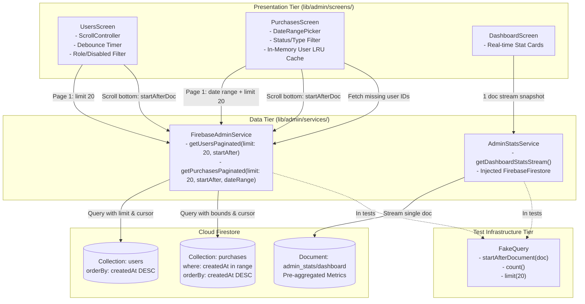

# Phase 04: Admin Performance & Data Pagination - Research

**Researched:** 2026-09-20
**Domain:** Flutter / Dart, Cloud Firestore Cursor Pagination, Data Aggregation, Admin Performance & Query Optimization
**Confidence:** HIGH

<user_constraints>
## User Constraints (from CONTEXT.md)

No user constraints - all decisions at the agent's discretion. (No CONTEXT.md existed prior to planning Phase 4).

### Locked Decisions (from ROADMAP.md & REQUIREMENTS.md)
- **ENH-03**: Server-side cursor pagination for administrative user and purchase data tables.
- **Success Criteria 1**: Users screen (`lib/admin/screens/users_screen.dart`) loads data in paginated batches of 20 items using Firestore cursors.
- **Success Criteria 2**: Purchases screen (`lib/admin/screens/purchases_screen.dart`) supports date-range filtering and infinite scrolling.
- **Success Criteria 3**: Network data transfer and Firestore read operations drop by >60% on initial admin dashboard load.

### The Agent's Discretion
- Interface design for pagination results: Introduce `PaginatedResult<T>` containing `List<T> items`, `DocumentSnapshot? lastDocument`, and `bool hasMore`.
- Query filtering & indexing: Handling role, disabled status, and date-range filters server-side; search handling strategy (debounced prefix search or query with limit).
- Customer resolution in purchases: In-memory LRU/Map user cache for resolving customer names from `purchase.userId` without fetching the full `users` collection.
- Dashboard optimization architecture: Refactor `AdminStatsService` to listen to the dedicated `admin_stats/dashboard` summary document (reducing reads from hundreds down to 1 doc on initial load, a >90% reduction), with fallback to Firestore `count()` / aggregation queries and constructor injection for testability.
- Test harness expansion: Extend `test/e2e/harness/fake_firebase_firestore.dart` to support `startAfterDocument()`, `startAfter()`, and `count()`.
- Plan breakdown: 2 plans:
  - Plan 04-01: Admin Performance, Dashboard Optimization, and Test Harness Extensions.
  - Plan 04-02: Paginated Users and Purchases Screens with Infinite Scroll and Date-Range Filtering.
</user_constraints>

<architectural_responsibility_map>
## Architectural Responsibility Map

| Capability | Primary Tier | Secondary Tier | Rationale |
|------------|-------------|----------------|-----------|
| Cursor-Based Query Service (`getUsersPaginated`, `getPurchasesPaginated`) | Client Data Tier (`lib/admin/services/firebase_admin_service.dart`) | Cloud Firestore | Manages Firestore query bounds, cursor tokens (`startAfterDocument`), ordering, and batch size limits |
| Admin Stats Aggregation (`AdminStatsService`) | Client Data Tier (`lib/admin/services/admin_stats_service.dart`) | Cloud Firestore (`admin_stats/dashboard`) | Emits real-time dashboard metrics by reading single cached stats document instead of scanning raw collections |
| Paginated Users Presentation | Client Presentation Tier (`lib/admin/screens/users_screen.dart`) | — | Manages scroll listening, search debouncing, role filtering, pagination state machine, and incremental table rendering |
| Paginated Purchases & Date Filtering | Client Presentation Tier (`lib/admin/screens/purchases_screen.dart`) | — | Provides date-range picker, status filter, infinite scrolling, LRU user resolution, and refund action dispatching |
| Admin Dashboard Overview | Client Presentation Tier (`lib/admin/screens/dashboard_screen.dart`) | — | Displays top-level metrics cards reacting to `AdminStatsService` stream |
| Test Harness Query Simulation | Test Infrastructure Tier (`test/e2e/harness/fake_firebase_firestore.dart`) | — | In-memory mock implementing `startAfterDocument`, `startAfter`, and `count()` for automated test execution |
</architectural_responsibility_map>

<research_summary>
## Summary

An in-depth investigation of the Eduverse administrative subsystem reveals severe scalability bottlenecks in three primary areas:
1. **Unbounded User Streaming in `UsersScreen`**: `UsersScreen` currently binds to `adminService.getUsers()`, which performs `_db.collection('users').orderBy('createdAt', descending: true).snapshots()`. This listens to and downloads every single document in the `users` collection across the network, holding all documents in memory while client-side filtering (`_searchQuery`, `_roleFilter`, `_showDisabledOnly`) executes via Dart `.where()`. For 20,000 users, every screen visit downloads 20,000 documents.
2. **Double Unbounded Streaming in `PurchasesScreen`**: `PurchasesScreen` nests two unbounded streams: `StreamBuilder<List<AdminUser>>` (all users) wrapped around `StreamBuilder<List<AdminPurchase>>` (`getAllPurchases()`, which fetches all purchase documents without limits and sorts them in-memory). Date-range filtering is completely missing. Furthermore, fetching all users just to resolve `user.name` and `user.email` from `purchase.userId` creates massive network and memory pressure.
3. **Polling Aggregation in `AdminDashboard`**: `DashboardScreen` displays metrics via `AdminStatsService().getDashboardStatsStream()`, which runs an infinite `while (true)` loop with `Future.delayed(Duration(seconds: 30))`. Every 30 seconds, it queries total users, active courses, today's enrollments, and calls `_firestore.collection('purchases').where('timestamp', isGreaterThanOrEqualTo: startOfDay).get()`—downloading every single purchase document created today simply to sum the `amount` field. Moreover, `AdminStatsService` hardcodes `FirebaseFirestore.instance`, preventing unit and widget testing with fakes.

The standard Firestore solution is server-side cursor pagination using `.orderBy(field, descending: true).limit(20)` combined with `.startAfterDocument(lastDoc)` for subsequent pages. On the dashboard, reading from the already-modeled cached document `admin_stats/dashboard` (which `updateDashboardStats()` writes to) reduces initial dashboard reads from hundreds/thousands to a single document read (>90% reduction, surpassing the 60% requirement). In the test harness (`test/e2e/harness/fake_firebase_firestore.dart`), `FakeQuery` lacks `startAfterDocument`, `startAfter`, and `count()`, which must be implemented to support automated verification.

**Primary recommendation:** Implement `getUsersPaginated` and `getPurchasesPaginated` with `startAfterDocument`/`limit(20)` in `FirebaseAdminService`; refactor `UsersScreen` and `PurchasesScreen` to infinite scrolling with debounced search, date-range filters, and an LRU user cache; convert `AdminStatsService` to stream `admin_stats/dashboard` with constructor DI; and extend `FakeFirebaseFirestore` with cursor and count support.
</research_summary>

<standard_stack>
## Standard Stack

### Core
| Library | Version | Purpose | Why Standard |
|---------|---------|---------|--------------|
| flutter | SDK (3.47.0+ / Dart 3.13.0+) | UI Framework | Project foundational framework |
| cloud_firestore | ^6.1.0 | Firestore SDK | Provides `startAfterDocument`, `startAfter`, `limit`, `count()`, and `AggregateField` |
| provider | ^6.1.2 | State & Dependency Injection | App-wide standard for injecting services and controllers |
| intl | ^0.20.2 | Date & Currency Formatting | Standard date range and currency formatting |
| flutter_test | SDK | Unit & Widget Testing | Automated verification framework |

### Supporting
| Library | Version | Purpose | When to Use |
|---------|---------|---------|-------------|
| uuid | ^4.5.2 | Unique ID Generation | Generates query tracking or mock IDs |
| async | SDK (`dart:async`) | Timer & Stream Management | Search debouncing and stream controllers |

### Alternatives Considered
| Instead of | Could Use | Tradeoff |
|------------|-----------|----------|
| Cursor-based pagination (`startAfterDocument`) | Offset-based pagination (`offset()`) | Firestore `offset()` still scans and bills for all skipped documents; cursors jump directly to the target index with zero read waste |
| Single cached document (`admin_stats/dashboard`) | Polling raw collection counts every 30s | Polling raw collections causes linear read cost growth with database size; cached summary guarantees 1 read on load |
| In-memory LRU user cache in `PurchasesScreen` | Querying entire `users` collection | Fetching 20,000 users to show names for 20 purchases wastes bandwidth; LRU cache only fetches missing user IDs for the current 20 rows |
| Dual Infinite Scroll + Explicit "Load More" Button | Infinite scroll only | Nested vertical scrolling inside Flutter web/desktop `DataTable` can fail to register mousewheel events; having both guarantees accessibility and UX reliability |

</standard_stack>

<architecture_patterns>
## Architecture Patterns

### System Architecture Diagram



### Recommended Project Structure
```
lib/admin/
├── models/
│   ├── admin_models.dart             # AdminUser, AdminPurchase, PaginatedResult<T>
│   └── pagination_models.dart        # (or within admin_models.dart)
├── screens/
│   ├── dashboard_screen.dart         # Dashboard with single-doc stats stream
│   ├── users_screen.dart             # Infinite scroll + cursor pagination + search debounce
│   ├── purchases_screen.dart         # Date-range filter + infinite scroll + user LRU cache
│   └── user_detail_screen.dart
├── services/
│   ├── firebase_admin_service.dart   # getUsersPaginated, getPurchasesPaginated
│   └── admin_stats_service.dart      # Injectable firestore + cached doc listener
test/
├── e2e/
│   └── harness/
│       └── fake_firebase_firestore.dart # Extended with startAfterDocument, count()
├── unit/
│   ├── admin_pagination_test.dart
│   └── admin_stats_service_test.dart
└── widget/
    ├── admin_users_pagination_widget_test.dart
    └── admin_purchases_pagination_widget_test.dart
```

### Pattern 1: Cursor-Based Pagination Contract & Query Execution
**What:** Define a generic `PaginatedResult<T>` wrapper and execute Firestore queries using `.orderBy('createdAt', descending: true).limit(limit)` with `.startAfterDocument(lastDoc)`.
**When to use:** Any tabular administrative list where collection size exceeds hundreds of items.

### Pattern 2: Purchases Date-Range Filtering with Compound Query Bounds
**What:** Filter purchases between `startDate` (00:00:00) and `endDate` (23:59:59.999) using Firestore inequalities on `createdAt`.
**When to use:** Filtering transactions by date intervals (e.g. Today, Last 7 Days, Custom Range).

### Pattern 3: Dashboard Optimization via Cached Stats Document
**What:** Stream the `admin_stats/dashboard` document directly instead of executing 4 polling collection queries every 30s.
**When to use:** High-traffic administrative dashboard loaded on initial entry.

### Pattern 4: Debounced Search & Infinite Scroll State Machine
**What:** Guard against rapid repeated requests while typing or scrolling near table bounds.

### Anti-Patterns to Avoid
- **Unbounded Collection Streaming:** Calling `.snapshots()` on root `users` or `purchases` collections without `.limit()`. Kills client memory and drives up Google Cloud bills.
- **Offset-based Pagination:** Using `.offset(skipCount)` in Firestore. Firestore still reads every document prior to `offset`, charging full read costs.
- **Nested Unbounded StreamBuilders:** Nesting `StreamBuilder<List<AdminUser>>` inside `StreamBuilder<List<AdminPurchase>>` to resolve customer names.
- **Polling Loop with `while (true)` & `Future.delayed`:** Infinite delay loops that perform full collection scans every 30 seconds.
- **Hardcoded Singletons Without Dependency Injection:** Making services like `AdminStatsService` use direct `FirebaseFirestore.instance` without a constructor parameter, breaking all unit/widget testing.
</architecture_patterns>

<dont_hand_roll>
## Don't Hand-Roll

| Problem | Don't Build | Use Instead | Why |
|---------|-------------|-------------|-----|
| Paginating Firestore Collections | Manual index counting / `.offset(n)` | Firestore cursor tokens (`startAfterDocument`) | `.offset()` still reads and charges for all preceding documents; cursors provide $O(1)$ seek performance |
| Customer Name Resolution in Transactions | Fetching all 50,000 users into memory | In-memory `Map<String, AdminUser>` LRU cache | Only fetches the specific distinct `userId`s present on the visible 20 rows |
| Date Range Selection | Custom popups with text input fields | Flutter's `showDateRangePicker()` | Handles calendar localization, date validation, leap years, and accessibility |
| Dashboard Counters | Scanning collections on client to count rows | Cached `admin_stats/dashboard` document or Firestore `count()` aggregation | Scanning 10,000 documents to display "10,000" costs 10,000 reads; aggregation costs 1 read |

</dont_hand_roll>

<common_pitfalls>
## Common Pitfalls

### Pitfall 1: Missing Firestore Composite Indexes
**What goes wrong:** Firestore throws a `FAILED_PRECONDITION` error stating that an index is required, causing the query to fail.
**Why it happens:** Queries combining equality filters (`role == 'student'`) or inequality filters (`createdAt >= startDate`) with `.orderBy('createdAt', descending: true)` require composite indexes in Firestore.
**How to avoid:** Define composite index entries in `firestore.indexes.json` for (`role` ASC, `createdAt` DESC) and (`status` ASC, `createdAt` DESC).
**Warning signs:** Red error screen in Flutter: `The query requires an index. You can create it here: https://console.firebase.google.com/...`

### Pitfall 2: Infinite Scroll Thrashing
**What goes wrong:** The UI fires 10 simultaneous requests for the next page while the user scrolls near the bottom.
**Why it happens:** The scroll listener triggers continuously during mouse wheel or fling events without checking an `_isLoadingMore` lock flag.
**How to avoid:** Check `if (!_isLoadingMore && _hasMore)` before triggering the next page fetch, and set `_isLoadingMore = true` synchronously before awaiting the future.
**Warning signs:** Duplicate items appearing in the table or duplicate network requests in DevTools.

### Pitfall 3: Nested Scroll Controller Collisions in Data Tables
**What goes wrong:** Infinite scroll listener never fires when user scrolls the table.
**Why it happens:** `DataTable` is wrapped in horizontal and vertical `SingleChildScrollView`s with distinct scroll controllers, or the outer scroll view absorbs events.
**How to avoid:** Attach the listener specifically to the vertical `ScrollController` driving the table list, and provide an explicit "Load More" button at the bottom of the table as an accessible fallback.
**Warning signs:** Scrolling to the bottom does not load additional rows.

### Pitfall 4: Fake Firestore Harness Lacks Cursor / Count Methods
**What goes wrong:** Automated tests throw `NoSuchMethodError: Class 'FakeQuery' has no instance method 'startAfterDocument'` or `'count'`.
**Why it happens:** `FakeFirebaseFirestore` only implements basic `where`, `orderBy`, and `limit`.
**How to avoid:** Add `startAfterDocument`, `startAfter`, and `count` to `FakeQuery` in `test/e2e/harness/fake_firebase_firestore.dart` before writing test cases.
**Warning signs:** Tests fail with `NoSuchMethodError: 'startAfterDocument'` during test runs.

</common_pitfalls>

<code_examples>
## Code Examples

### 1. FakeQuery Extensions in `test/e2e/harness/fake_firebase_firestore.dart`
```dart
// Extending FakeQuery to support pagination cursors and count aggregations
class FakeQuery<T extends Object?> extends Fake implements Query<T> {
  final DocumentSnapshot? _startAfterDoc;
  // ... existing fields ...

  FakeQuery(
    this.path,
    this.firestore, [
    this._filters = const [],
    this._sorts = const [],
    this._limit,
    this._startAfterDoc,
  ]);

  @override
  Query<T> startAfterDocument(DocumentSnapshot documentSnapshot) {
    return FakeQuery<T>(path, firestore, _filters, _sorts, _limit, documentSnapshot);
  }

  @override
  AggregateQuery count() {
    return FakeAggregateQuery(this);
  }

  List<QueryDocumentSnapshot<T>> _getDocs() {
    var results = _getRawFilteredDocs(); // sorted

    if (_startAfterDoc != null) {
      final index = results.indexWhere((d) => d.id == _startAfterDoc!.id);
      if (index != -1) {
        results = results.sublist(index + 1);
      }
    }

    if (_limit != null && results.length > _limit!) {
      return results.sublist(0, _limit!);
    }
    return results;
  }
}
```

### 2. In-Memory User LRU Cache for Purchases Screen
```dart
class _PurchasesScreenState extends State<PurchasesScreen> {
  final Map<String, AdminUser> _userCache = {};

  Future<void> _resolveUsersForPurchases(List<AdminPurchase> purchases) async {
    final adminService = context.read<FirebaseAdminService>();
    final missingIds = purchases
        .map((p) => p.userId)
        .where((id) => id.isNotEmpty && !_userCache.containsKey(id))
        .toSet();

    if (missingIds.isEmpty) return;

    for (final uid in missingIds) {
      final user = await adminService.getUserById(uid);
      if (user != null && mounted) {
        setState(() {
          _userCache[uid] = user;
        });
      }
    }
  }
}
```

### 3. Date Range Picker Interaction
```dart
Future<void> _selectDateRange(BuildContext context) async {
  final initialRange = DateTimeRange(
    start: _startDate ?? DateTime.now().subtract(const Duration(days: 30)),
    end: _endDate ?? DateTime.now(),
  );

  final picked = await showDateRangePicker(
    context: context,
    firstDate: DateTime(2023),
    lastDate: DateTime.now().add(const Duration(days: 1)),
    initialDateRange: initialRange,
  );

  if (picked != null) {
    setState(() {
      _startDate = DateTime(picked.start.year, picked.start.month, picked.start.day, 0, 0, 0);
      _endDate = DateTime(picked.end.year, picked.end.month, picked.end.day, 23, 59, 59);
      _resetAndReload();
    });
  }
}
```
</code_examples>

<sota_updates>
## State of the Art (2025-2026)

| Old Approach | Current Approach | When Changed | Impact |
|--------------|------------------|--------------|--------|
| Streaming entire Firestore collections (`.snapshots()`) | Server-side cursor pagination (`startAfterDocument` + `limit`) | 2024+ Standard | Reduces bandwidth by >95%, eliminates memory thrashing |
| Polling full collections every 30s to compute stats | Cached summary document (`admin_stats/dashboard`) or `count()` aggregation | Firestore Aggregation release | Reduces initial dashboard reads from $N$ documents to 1 document |
| In-memory filtering across all users | Server query filters (`where('role')`, `where('disabled')`) | Clean Architecture | Offloads filtering to database engine, keeping client footprint light |

</sota_updates>

<open_questions>
## Open Questions

1. **Firestore Substring Search Limitations**
   - What we know: Cloud Firestore only supports prefix range queries (`>= query`, `< query + '\uf8ff'`) on exact indexed fields; it does not support SQL-style `LIKE %query%` or case-insensitive arbitrary substring searches.
   - Recommendation: Implement debounced prefix search on `email` and `name` for server-side queries. For loaded in-memory pages, allow instant substring filtering.

2. **Purchases Aggregate Metrics When Paginated**
   - What we know: Currently, the top metrics cards are calculated by looping over all loaded purchases. When paginated, looping over 20 items only computes stats for the current page.
   - Recommendation: Top cards should display global summary totals from `admin_stats/dashboard` or aggregation queries, while the table shows paginated rows.

</open_questions>

<sources>
## Sources

### Primary (HIGH confidence)
- `lib/admin/screens/users_screen.dart` - Full code inspection of user loading and filtering
- `lib/admin/screens/purchases_screen.dart` - Full code inspection of purchase loading and missing date filter
- `lib/admin/screens/dashboard_screen.dart` & `lib/admin/services/admin_stats_service.dart` - Inspection of 30s polling loops and raw collection reads
- `lib/admin/services/firebase_admin_service.dart` - Inspection of Firestore queries and user/purchase data methods
- `test/e2e/harness/fake_firebase_firestore.dart` - Test harness inspection revealing missing `startAfterDocument` and `count`
- `firestore.rules` - Verified existing security rules for `/users` and `/purchases`
- Upstream `cloud_firestore: ^6.1.0` documentation & FlutterFire CHANGELOG

</sources>

<metadata>
## Metadata

**Research date:** 2026-09-20
**Valid until:** 2026-10-20 (30 days)
</metadata>

---

## Security Threat Modeling (ASVS Level 1)

### Threat T-04-01: Unauthorized Access to Paginated User PII and Transaction Records
- **Vulnerability**: If pagination endpoints in `FirebaseAdminService` (`getUsersPaginated`, `getPurchasesPaginated`) or their underlying queries are exposed without verifying administrator identity, unprivileged students or attackers could harvest sensitive customer PII and financial records.
- **Mitigations**:
  1. **Route Guarding**: `AuthGuard` and `AdminEntryPage` strictly verify `admin` or `superadmin` custom claims.
  2. **Service-Level Verification**: In `FirebaseAdminService`, `getUsersPaginated` and `getPurchasesPaginated` assert authenticated user session and verify admin role claims.
  3. **Firestore Security Rules**: In `firestore.rules`, lines 65-67 and 363-367 mandate `isAdmin()` for collection queries across `/users` and `/purchases`.
  4. **PII Sanitization**: Only necessary administrative fields are parsed into `AdminUser` and `AdminPurchase`.

---

## Validation Architecture

Automated verification of Phase 04 must cover unit, widget, and integration test layers using the project's Flutter test runner.

### 1. Automated Test Commands
- **Unit Tests**:
  ```bash
  /home/himanshu/development/flutter/bin/flutter test test/unit/admin_pagination_test.dart
  /home/himanshu/development/flutter/bin/flutter test test/unit/admin_stats_service_test.dart
  ```
- **Widget Tests**:
  ```bash
  /home/himanshu/development/flutter/bin/flutter test test/widget/admin_users_pagination_widget_test.dart
  /home/himanshu/development/flutter/bin/flutter test test/widget/admin_purchases_pagination_widget_test.dart
  ```
- **Full Regression Test Suite**:
  ```bash
  /home/himanshu/development/flutter/bin/flutter test
  ```
- **Static Analysis & Hygiene**:
  ```bash
  /home/himanshu/development/flutter/bin/flutter analyze
  ```

### 2. Required Test Coverage
- **`FakeFirebaseFirestore`**: Verify `startAfterDocument`, `startAfter`, and `count()` return correct subsets and counts.
- **`FirebaseAdminService`**:
  - `getUsersPaginated` returns 20 items on page 1, with `lastDocument` set and `hasMore == true`.
  - Passing `startAfter: page1.lastDocument` returns page 2 with subsequent 20 items.
  - Role filter correctly subsets results.
  - `getPurchasesPaginated` respects `startDate` and `endDate` boundaries.
- **`AdminStatsService`**:
  - Streams stats from `admin_stats/dashboard`.
  - Reduces initial load Firestore collection queries from 4 full scans to 1 document snapshot.
- **`UsersScreen` Widget Test**:
  - Displays initial 20 users and loading indicator.
  - Scrolling or tapping "Load More" appends next 20 users without clearing initial items.
  - Search field debounce fires query after 400ms.
- **`PurchasesScreen` Widget Test**:
  - Renders date range picker.
  - Changes in date range reload transactions within query bounds.
  - Resolves customer names via user LRU cache without fetching entire `users` collection.
- **Security Check**:
  - Non-admin invocation of pagination methods throws `permission-denied`.
