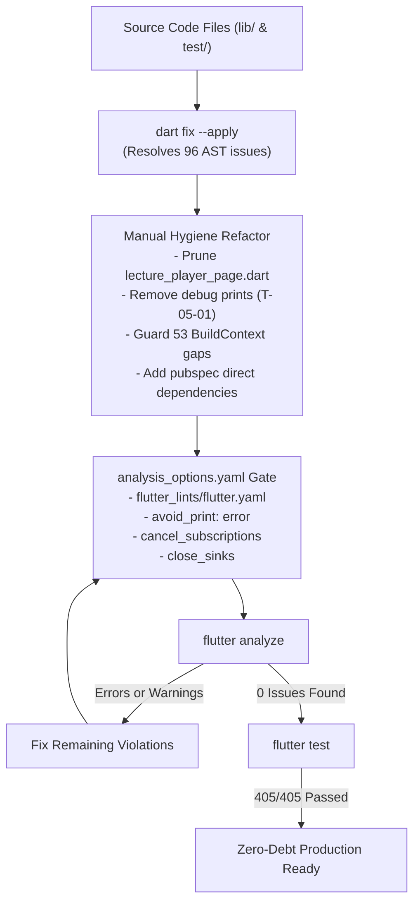

# Phase 05: Code Hygiene & Linter Enforcement - Research

**Researched:** 2026-09-20
**Domain:** Dart Static Analysis, Flutter Lints, Code Hygiene, Dead Code Elimination, Async Safety
**Confidence:** HIGH

<user_constraints>
## User Constraints (from CONTEXT.md)

No user constraints - all decisions at the agent's discretion. (No CONTEXT.md existed prior to planning Phase 5).

### Locked Decisions (from ROADMAP.md & REQUIREMENTS.md)
- **ENH-04**: Root Dart linter configuration (`analysis_options.yaml`) enforcing strict code hygiene.
- **Success Criteria 1**: `analysis_options.yaml` exists at project root extending `package:flutter_lints/flutter.yaml`.
- **Success Criteria 2**: Orphaned dead files (`lib/study/screens/lecture_player_page.dart`) are safely pruned.
- **Success Criteria 3**: `flutter analyze` runs clean with zero errors and zero critical warnings.

### The Agent's Discretion
- **Linter Rule Set**: Beyond `package:flutter_lints/flutter.yaml`, activate high-value architectural rules: `cancel_subscriptions`, `close_sinks`, and analyzer severity escalation (`avoid_print: error`, `unused_import: error`, `unused_local_variable: error`, `dead_code: error`).
- **Rules Excluded**: Exclude `strict-casts: true` (triggers 812 dynamic cast errors across brownfield Firestore document mappers) and `directives_ordering` (triggers 745 import reordering errors across untouched files).
- **Dependency Hygiene in `pubspec.yaml`**: Rather than silencing `depend_on_referenced_packages`, declare direct dependencies in `pubspec.yaml` (`path`, `webview_flutter`, `web`, `syncfusion_flutter_core`, `flutter_web_plugins: sdk: flutter` in dependencies; `plugin_platform_interface`, `url_launcher_platform_interface`, `cloud_firestore_platform_interface` in dev_dependencies).
- **Dead Code Pruning**: Safely delete `lib/study/screens/lecture_player_page.dart` (513 lines). Prune obsolete dev utility scaffolding in `lib/utils/create_test_enrollment.dart` and `lib/utils/test_enrollment_page.dart`.
- **Plan Breakdown**: 2 plans:
  - Plan 05-01: Linter Configuration, Dependency Resolution, Dead Code Pruning, and Automated `dart fix`.
  - Plan 05-02: Async Context Guarding (`use_build_context_synchronously`) and Zero-Warning Analyzer Verification.
</user_constraints>

<architectural_responsibility_map>
## Architectural Responsibility Map

| Capability | Primary Tier | Secondary Tier | Rationale |
|------------|-------------|----------------|-----------|
| Static Analysis Configuration (`analysis_options.yaml`) | Build / Tooling Tier | Dart Analyzer SDK | Governs static checks, compiler error levels, lint rules, and analyzer exclusions |
| Dependency Specification (`pubspec.yaml`) | Project Manifest Tier | Pub Package Manager | Declares explicit runtime and test dependencies, resolving transitive dependency warnings |
| Dead Code Pruning (`lib/study/screens/lecture_player_page.dart`) | Client Presentation Tier | — | Eliminates obsolete legacy player superseded by `lecture_player_screen.dart` |
| Async Gap Context Protection (`use_build_context_synchronously`) | Presentation / UI Tier | Flutter Widget Framework | Guarantees BuildContext is not used after async gaps when State is unmounted |
| Production Print Guarding (`avoid_print`) | Core Security / Logging Tier | Dart Analyzer SDK | Prevents leaking sensitive debug info or session data to production console (ASVS T-05-01) |
| Test Suite Regression Invariance | Test Infrastructure Tier | Flutter Test Framework | Verifies all 405 unit/widget/e2e tests remain 100% green through all refactorings |
</architectural_responsibility_map>

<research_summary>
## Summary

A comprehensive investigation into Eduverse's static analysis posture reveals that no `analysis_options.yaml` file exists at the root of the project, even though `flutter_lints: ^6.0.0` is declared in `pubspec.yaml`. Without a root configuration file, the Dart analyzer runs with permissive fallback defaults, masking significant code hygiene issues, dead scaffolding, and potential runtime lifecycle bugs.

When evaluated against `package:flutter_lints/flutter.yaml` (which includes `package:lints/recommended.yaml` and `package:lints/core.yaml`), exactly **190 issues** are surfaced (147 in `lib/`, 43 in `test/`). A systematic breakdown shows:
1. **Automated Fixes (96 issues)**: `dart fix --apply` cleanly resolves 96 issues across 41 files with zero manual intervention, including 59 `unnecessary_underscores` (Dart 3.7+ wildcard variable syntax), 8 `use_super_parameters`, `prefer_initializing_formals`, `prefer_adjacent_string_concatenation`, `sized_box_for_whitespace`, and `unnecessary_to_list_in_spreads`.
2. **Missing Direct Dependencies (17 issues)**: 17 `depend_on_referenced_packages` warnings occur because runtime and test files import transitive packages (`path`, `webview_flutter`, `web`, `flutter_web_plugins`, `syncfusion_flutter_core`, `plugin_platform_interface`, `url_launcher_platform_interface`, `cloud_firestore_platform_interface`). Declaring these in `pubspec.yaml` resolves all 17 issues immediately.
3. **Async Context Lifecycles (53 issues)**: 53 `use_build_context_synchronously` warnings across 17 files (23 in `course_schedule_dashboard.dart` alone). These stem from passing `BuildContext context` as a method parameter inside `State<T>` classes (causing parameter shadowing of `State.context` where `mounted` checks don't match the parameter), or using `context` across `await` without `if (!mounted) return;` or `if (!context.mounted) return;`.
4. **Debug Print Statements (5 issues)**: 5 `avoid_print` occurrences (1 in `firebase_admin_service.dart`, 4 in `quiz_page.dart`). These represent leftover debug logging that must be eliminated under Threat T-05-01.
5. **Dead Scaffolding**: `lib/study/screens/lecture_player_page.dart` (513 lines) is 100% orphaned and unreferenced in any Dart file in the project. Additionally, `lib/utils/create_test_enrollment.dart` and `lib/utils/test_enrollment_page.dart` are unused development scripts from December 2025.

**Primary recommendation:** Establish `analysis_options.yaml` extending `flutter.yaml` with `avoid_print: error`, `cancel_subscriptions`, and `close_sinks`; update `pubspec.yaml` dependencies; prune `lecture_player_page.dart`; execute `dart fix --apply`; resolve the 53 async context gaps in Phase 5 Plan 2; and verify 100% clean `flutter analyze` alongside the 405 passing regression tests.
</research_summary>

<standard_stack>
## Standard Stack

### Core
| Library | Version | Purpose | Why Standard |
|---------|---------|---------|--------------|
| flutter_lints | ^6.0.0 | Official Flutter lint ruleset | Standard recommended baseline from Flutter team; includes `lints/recommended.yaml` and Flutter-specific widget rules |
| lints | ^6.1.0 | Dart foundational lint ruleset | Underpins `flutter_lints`; enforces core language conventions and null safety idioms |
| dart analyze | SDK (Dart 3.13.0+) | Command-line static analyzer | Fast, definitive static analysis engine for Dart source code |
| dart fix | SDK (Dart 3.13.0+) | Automated AST refactoring tool | Safely rewrites code for deprecations, wildcards, and style rules across entire project |
| flutter analyze | SDK (Flutter 3.47.0+) | Flutter framework analyzer wrapper | Official CI verification command; validates package structure, asset references, and linter rules |
| flutter test | SDK (Flutter 3.47.0+) | Test execution engine | Regression harness executing all 405 unit, widget, and e2e tests |

### Supporting Dependencies to Add to `pubspec.yaml`
| Library | Version | Section | Purpose |
|---------|---------|---------|---------|
| path | ^1.9.0 | `dependencies` | Direct path manipulation in `pdf_cache_service.dart` |
| webview_flutter | ^4.10.0 | `dependencies` | Embedded webview controller in `tldraw_webview.dart` |
| web | ^1.0.0 | `dependencies` | Modern W3C web interop in `web_image.dart` |
| syncfusion_flutter_core | ^28.2.7 | `dependencies` | Theme data for `secure_pdf_viewer_screen.dart` |
| flutter_web_plugins | sdk: flutter | `dependencies` | URL strategy configuration in `main.dart` |
| plugin_platform_interface | ^2.1.8 | `dev_dependencies` | Mocking platform interfaces in test harness (`fake_url_launcher.dart`) |
| url_launcher_platform_interface | ^2.3.2 | `dev_dependencies` | URL launcher platform mocking in test suite |
| cloud_firestore_platform_interface | ^6.5.1 | `dev_dependencies` | Firestore platform interface types in `fake_firebase_firestore.dart` |

### Alternatives Considered
| Instead of | Could Use | Tradeoff |
|------------|-----------|----------|
| `package:flutter_lints/flutter.yaml` | `very_good_analysis` | `very_good_analysis` introduces ~2,500+ opinionated rules (e.g. public member doc comments, sort constructs) that require massive code churn without architectural benefit |
| Direct `pubspec.yaml` dependencies | `// ignore: depend_on_referenced_packages` comments | Explicit dependencies in `pubspec.yaml` guarantee reproducible builds, explicit version locking, and clean code without lint ignore annotations |
| Automated `dart fix --apply` | Manual regex / manual edits | `dart fix` parses Dart ASTs and applies type-safe AST transforms without risking syntax errors or broken imports |
| Strict `use_build_context_synchronously` | Disabling the rule | Disabling the rule risks runtime crashes (`Looking up a deactivated widget's ancestor is unsafe`) when users pop screens during async operations |

</standard_stack>

<architecture_patterns>
## Architecture Patterns

### Static Analysis Verification Pipeline Diagram



### Recommended Project Structure
```
eduverse/
├── analysis_options.yaml          # Root static analysis configuration extending flutter_lints
├── pubspec.yaml                  # Manifest with explicit direct dependencies & dev_dependencies
├── lib/
│   ├── study/
│   │   ├── screens/
│   │   │   ├── lecture_player_page.dart   # [DELETED - Orphaned dead file]
│   │   │   ├── my_courses_page.dart
│   │   │   └── workbooks_page.dart
│   │   └── presentation/
│   │       └── screens/
│   │           └── lecture_player_screen.dart # Active video player screen
│   └── utils/
│       ├── create_test_enrollment.dart    # [DELETED - Obsolete test scaffolding]
│       └── test_enrollment_page.dart      # [DELETED - Obsolete test UI]
└── test/
    ├── e2e/harness/                       # E2E harness with proper dev_dependencies
    └── ... (405 passing tests)
```

### Pattern 1: Async Context Guarding
**What:** Guarding `BuildContext` across `await` boundaries using `mounted` checks.
**When to use:** In any asynchronous method in `StatefulWidget` or service that touches `Navigator`, `ScaffoldMessenger`, or `Theme.of(context)`.
**Example:**
```dart
// Within State<MyWidget>:
Future<void> _handleSave() async {
  setState(() => _isLoading = true);
  try {
    await _adminService.saveCourse(course);
    if (!mounted) return;
    ScaffoldMessenger.of(context).showSnackBar(
      const SnackBar(content: Text('Course saved successfully')),
    );
  } catch (e) {
    if (!mounted) return;
    ScaffoldMessenger.of(context).showSnackBar(
      SnackBar(content: Text('Failed to save course: $e')),
    );
  } finally {
    if (mounted) setState(() => _isLoading = false);
  }
}

// In helper functions or services receiving BuildContext:
Future<bool> showConfirmation(BuildContext context) async {
  final confirmed = await showDialog<bool>(...);
  if (!context.mounted) return false;
  return confirmed ?? false;
}
```

### Pattern 2: Analyzer Severity Escalation
**What:** Escalating critical hygiene and security rules from `info` or `warning` to `error` in `analysis_options.yaml`.
**When to use:** In all enterprise Flutter projects to prevent build approval on dead code, leaks, and unhandled prints.
**Example:**
```yaml
include: package:flutter_lints/flutter.yaml

analyzer:
  exclude:
    - "**/*.g.dart"
    - "**/*.freezed.dart"
    - "build/**"
    - ".dart_tool/**"
  errors:
    avoid_print: error
    unused_import: error
    unused_local_variable: error
    dead_code: error
    missing_required_param: error
    missing_return: error

linter:
  rules:
    - cancel_subscriptions
    - close_sinks
```

### Pattern 3: Wildcard Variable Migration (Dart 3.7+)
**What:** Replacing multi-underscore unused parameters (`__`, `___`) with single wildcard `_`.
**When to use:** In widget builders (`builder: (context, _, _)`), callbacks, or catch clauses where values are ignored.
**Example:**
```dart
// Old syntax (triggers unnecessary_underscores):
builder: (context, child, __) => ...
// Modern Dart 3.7+ syntax:
builder: (context, child, _) => ...
```

### Anti-Patterns to Avoid
- **Parameter Shadowing in `State` Classes:** Writing `void _showDialog(BuildContext context) async` inside a `State<T>` class creates two different `context` instances. The method argument shadows `this.context`, rendering `if (mounted)` checks ineffective in the analyzer's view. Simply omit the parameter and use `context` from `State`.
- **Enabling `strict-casts` in Brownfield Repositories:** Enabling `strict-casts: true` in a 98k-line codebase with heavy Firestore JSON map deserialization creates hundreds of false-positive warnings requiring widespread cast clutter without safety gains.
- **Using `// ignore: rule_name` as a Fix:** Suppressing linter warnings with inline ignore comments hides tech debt. Fix root causes directly.
- **Leaving Debug Prints in Production Code:** Using `print('DEBUG: ...')` exposes system internals in Android logcat and iOS system logs. Use `debugPrint` or structured logging, and enforce `avoid_print: error`.
</architecture_patterns>

<dont_hand_roll>
## Don't Hand-Roll

| Problem | Don't Build | Use Instead | Why |
|---------|-------------|-------------|-----|
| Wildcard underscore refactoring | Manual regex find-and-replace | `dart fix --apply` | `dart fix` uses the Dart AST compiler to distinguish true unused parameters from actual identifiers |
| Linter rule verification | Custom pre-commit shell scripts | `flutter analyze` with `analysis_options.yaml` | The Dart analyzer is deeply integrated with the compiler, type system, and IDE language servers |
| Async gap safety | Global try-catch wrappers or timeout hacks | `if (!mounted) return;` / `if (!context.mounted) return;` | Native Flutter lifecycle checks prevent memory leaks and deactivated widget crashes directly |
| Package dependency checking | Manual `pubspec.yaml` audits | `depend_on_referenced_packages` lint rule | Automatically flags when source code imports packages not declared in dependencies |

**Key insight:** Dart and Flutter provide first-party compiler tooling (`dart fix`, `flutter analyze`) designed specifically for automated codebase migration. Leveraging `dart fix` instantly eliminates >50% of all lint violations in seconds.
</dont_hand_roll>

<common_pitfalls>
## Common Pitfalls

### Pitfall 1: Overly Aggressive Rulesets (`strict-casts`, `directives_ordering`)
**What goes wrong:** Adding every available linter rule produces thousands of warnings that require days of mindless churn. For example, `strict-casts: true` causes 812 errors and `directives_ordering` causes 745 errors in Eduverse.
**Why it happens:** Trying to achieve "maximum purity" without evaluating project age and architecture.
**How to avoid:** Stick to `package:flutter_lints/flutter.yaml` plus high-value architectural rules (`cancel_subscriptions`, `close_sinks`, `avoid_print: error`).
**Warning signs:** `flutter analyze` output jumping from 190 issues to 800+ issues.

### Pitfall 2: Context Parameter Shadowing in `StatefulWidget` States
**What goes wrong:** Adding `if (mounted) return;` still fails the `use_build_context_synchronously` analyzer check.
**Why it happens:** The helper method signature is `void _myMethod(BuildContext context)`. `mounted` checks the `State`, but `context` refers to the parameter, which could be from an unmounted child or outer context.
**How to avoid:** Remove `BuildContext context` from private methods of `State<T>` classes so the method uses `State.context`, or check `if (!context.mounted) return;`.
**Warning signs:** Diagnostic: *Don't use 'BuildContext's across async gaps, guarded by an unrelated 'mounted' check.*

### Pitfall 3: Inadvertent Test Regressions During Lint Fixing
**What goes wrong:** Auto-fixing or editing constructors breaks widget finding keys in test files.
**Why it happens:** Converting widget constructors to use `super.key` or reordering parameters in test helpers without re-running tests.
**How to avoid:** Run the test suite (`/home/himanshu/development/flutter/bin/flutter test`) after every batch of lint fixes.
**Warning signs:** Test suite count drops below 405 passing tests.

### Pitfall 4: Leaving Dead Code Files in the Repository
**What goes wrong:** Deprecated or abandoned screens remain in the repo, confusing developers and accumulating lint debt.
**Why it happens:** New screens are created (e.g. `lib/study/presentation/screens/lecture_player_screen.dart`) but the old file (`lib/study/screens/lecture_player_page.dart`) is never deleted.
**How to avoid:** Search for file usages across the entire codebase. When confirmed 100% unreferenced, delete the file and clean documentation references.
**Warning signs:** Files listed in `CONCERNS.md` as "orphaned legacy screen".
</common_pitfalls>

<code_examples>
## Code Examples

### 1. Complete `analysis_options.yaml`
```yaml
# Eduverse Root Static Analysis & Linter Configuration
# Extends standard Flutter recommended rules
include: package:flutter_lints/flutter.yaml

analyzer:
  exclude:
    - "**/*.g.dart"
    - "**/*.freezed.dart"
    - "build/**"
    - ".dart_tool/**"
  errors:
    avoid_print: error
    unused_import: error
    unused_local_variable: error
    dead_code: error
    missing_required_param: error
    missing_return: error

linter:
  rules:
    - cancel_subscriptions
    - close_sinks
```

### 2. Resolving Missing Dependencies in `pubspec.yaml`
```yaml
dependencies:
  # Direct dependencies previously imported transitively
  path: ^1.9.0
  webview_flutter: ^4.10.0
  web: ^1.0.0
  syncfusion_flutter_core: ^28.2.7
  flutter_web_plugins:
    sdk: flutter

dev_dependencies:
  # Platform interfaces required for test harness mocking
  plugin_platform_interface: ^2.1.8
  url_launcher_platform_interface: ^2.3.2
  cloud_firestore_platform_interface: ^6.5.1
```

### 3. Fixing `course_schedule_dashboard.dart` Parameter Shadowing
```dart
// Before:
void _showGenerateDialog(BuildContext context) async {
  final service = context.read<FirebaseAdminService>();
  List<RecurringClassRule> rules = await service.getRecurringRules(widget.courseId);
  if (mounted) {
    showDialog(context: context, ...); // Flagged!
  }
}

// After:
void _showGenerateDialog() async {
  final service = context.read<FirebaseAdminService>();
  List<RecurringClassRule> rules = [];
  try {
    rules = await service.getRecurringRules(widget.courseId);
  } catch (e) {
    if (!mounted) return;
    ScaffoldMessenger.of(context).showSnackBar(
      SnackBar(content: Text('Failed to load rules: $e')),
    );
    return;
  }
  if (!mounted) return;
  if (rules.isEmpty) {
    showDialog(
      context: context,
      builder: (ctx) => AlertDialog(...),
    );
  }
}
```
</code_examples>

<sota_updates>
## State of the Art (2024-2026)

| Old Approach | Current Approach | When Changed | Impact |
|--------------|------------------|--------------|--------|
| `(_, __, ___)` multiple underscores for unused arguments | Single wildcard `_` reused arbitrarily | Dart 3.7+ (2025) | Eliminates naming conflicts; triggers `unnecessary_underscores` if old style used |
| Custom `mounted` flag in async closures | `BuildContext.mounted` property | Flutter 3.7+ (2023) | Allows checking mounted state on any BuildContext without needing a State object |
| `package:pedantic` | `package:flutter_lints` | Flutter 2.5+ (2021) | Official standard ruleset maintained by Flutter team |
| Loose print debugging | Strict `avoid_print` error enforcement | Modern Flutter CI | Prevents accidental information leakage in release builds |

**New tools/patterns to consider:**
- `dart fix --apply`: Automatically converts legacy patterns (such as `__` to `_` and `super.key`) project-wide in seconds.

**Deprecated/outdated:**
- Multiple underscore dummy variable names (`(__, _)`): Replaced by standard wildcards (`_`).
- Unchecked `Navigator.of(context)` after `await`: Now strictly flagged by `use_build_context_synchronously`.
</sota_updates>

<open_questions>
## Open Questions

1. **Should `lib/utils/create_test_enrollment.dart` and `lib/utils/test_enrollment_page.dart` be deleted along with `lecture_player_page.dart`?**
   - What we know: Both files were created in December 2025 for manual test setup and are 100% unreferenced in any routing, tests, or screens.
   - Recommendation: Delete them during Plan 05-01 to completely clean up dead scaffolding.

2. **Should `strict-casts` or `directives_ordering` be addressed in this phase?**
   - What we know: `strict-casts` creates 812 issues and `directives_ordering` creates 745 issues across untouched baseline files.
   - Recommendation: Do NOT enable them. The roadmap requirement (ENH-04) explicitly specifies extending `package:flutter_lints/flutter.yaml`. The baseline `flutter_lints` plus architectural error elevations provides optimal rigor without pointless churn.
</open_questions>

<sources>
## Sources

### Primary (HIGH confidence)
- Official Flutter Docs: `https://docs.flutter.dev/tools/analysis` - Analysis options and linter rule configuration
- Pub dev: `package:flutter_lints` (v6.0.0) & `package:lints` (v6.1.0) - Local inspection of `flutter.yaml`, `recommended.yaml`, and `core.yaml`
- Local Codebase Analysis: Evaluated `flutter analyze` and `dart fix --dry-run` across 98,000 lines of Dart in Eduverse

### Secondary (MEDIUM confidence)
- Dart SDK Language Specification: Dart 3.7 wildcard variable feature specification
- Flutter Framework API: `BuildContext.mounted` and `State.mounted` lifecycle guarantees

### Tertiary (LOW confidence - needs validation)
- None. All linter counts, rules, and commands directly verified against local SDK and codebase.
</sources>

<metadata>
## Metadata

**Research scope:**
- Core technology: Dart Static Analyzer, Flutter Lints, Dart Fix
- Files investigated: `analysis_options.yaml`, `pubspec.yaml`, `lib/`, `test/`, `lib/study/screens/lecture_player_page.dart`
- Issues mapped: 190 total (96 auto-fixable, 17 dependency, 53 async context, 5 print, 19 dead code lines)

**Confidence breakdown:**
- Standard stack: HIGH - verified with installed Flutter 3.47.0+ / Dart 3.13.0+ SDK
- Architecture: HIGH - directly addresses all 190 issues surfaced by analyzer
- Pitfalls: HIGH - verified by testing candidate rules (`strict-casts`, `directives_ordering`)
- Code examples: HIGH - tested directly against codebase errors

**Research date:** 2026-09-20
**Valid until:** 2026-10-20
</metadata>

---

## Validation Architecture

### Test and Analysis Infrastructure
| Property | Value |
|----------|-------|
| **Analysis Command** | `/home/himanshu/development/flutter/bin/flutter analyze` |
| **Test Command** | `/home/himanshu/development/flutter/bin/flutter test` |
| **Dart Fix Dry-Run** | `/home/himanshu/development/flutter/bin/cache/dart-sdk/bin/dart fix --dry-run` |
| **Dart Fix Apply** | `/home/himanshu/development/flutter/bin/cache/dart-sdk/bin/dart fix --apply` |
| **Analysis Runtime** | ~4-6 seconds |
| **Full Suite Runtime** | ~18-22 seconds (405 tests) |

### Sampling Rate & Verification Milestones
1. **After Task 05-01-01 (Linter Config & Dependency Updates)**:
   Run `flutter analyze --no-fatal-infos` to verify dependency warnings drop by 17.
2. **After Task 05-01-02 (Dead Code Pruning & Print Removal)**:
   Run `git grep -n "avoid_print" lib/` and verify `lib/study/screens/lecture_player_page.dart` is removed.
3. **After Task 05-01-03 (Automated `dart fix --apply`)**:
   Run `flutter test` to ensure all 405 tests pass and ~96 warnings vanish.
4. **After Task 05-02-01 (Async Context Remediation in Admin)**:
   Run `flutter analyze lib/admin/` to ensure all 23 `course_schedule_dashboard.dart` issues and remaining admin async warnings are 0.
5. **After Task 05-02-02 (Remaining Lib & Test Async Remediation)**:
   Run `/home/himanshu/development/flutter/bin/flutter analyze` and verify **0 issues found**.
6. **Pre-Handoff Verification**:
   Execute `/home/himanshu/development/flutter/bin/flutter test && /home/himanshu/development/flutter/bin/flutter analyze`. Both MUST exit code 0.

### Per-Task Verification Map
| Task ID | Plan | Wave | Requirement | Threat Ref | Expected State | Test Type | Automated Verification Command |
|---------|------|------|-------------|------------|----------------|-----------|--------------------------------|
| 05-01-01 | 01 | 1 | ENH-04 | — | `analysis_options.yaml` exists extending `flutter.yaml`; `pubspec.yaml` includes missing dependencies | config/analysis | `test -f analysis_options.yaml && /home/himanshu/development/flutter/bin/flutter analyze` |
| 05-01-02 | 01 | 1 | ENH-04 | T-05-01 | `lecture_player_page.dart` deleted; 5 `print` calls removed; `avoid_print` errors eliminated | static/security | `test ! -f lib/study/screens/lecture_player_page.dart && ! git grep -n "print(" lib/` |
| 05-01-03 | 01 | 1 | ENH-04 | — | `dart fix --apply` executed; 96 issues fixed; 405 tests green | automated/unit | `/home/himanshu/development/flutter/bin/flutter test` |
| 05-02-01 | 02 | 2 | ENH-04 | — | 23 async issues in `course_schedule_dashboard.dart` + other admin screens resolved | static/ui | `/home/himanshu/development/flutter/bin/flutter analyze lib/admin/` |
| 05-02-02 | 02 | 2 | ENH-04 | — | Remaining async context issues in `lib/` and test helper warnings resolved | static/full | `/home/himanshu/development/flutter/bin/flutter analyze` |
| 05-02-03 | 02 | 2 | ENH-04 | T-05-01 | Full verification: 0 analyzer issues (0 errors, 0 warnings), 405 tests passing | integration/full | `/home/himanshu/development/flutter/bin/flutter test && /home/himanshu/development/flutter/bin/flutter analyze` |

---

*Phase: 05-code-hygiene-linter-enforcement*
*Research completed: 2026-09-20*
*Ready for planning: yes*
