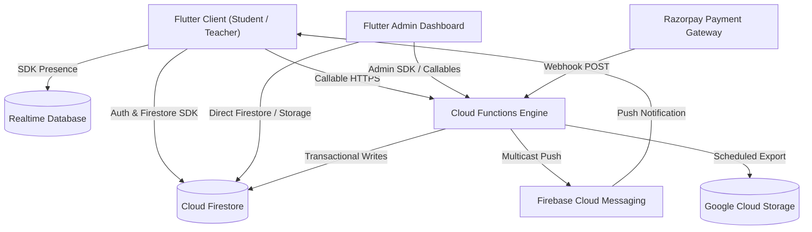
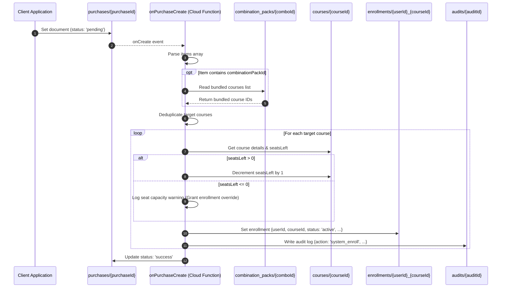
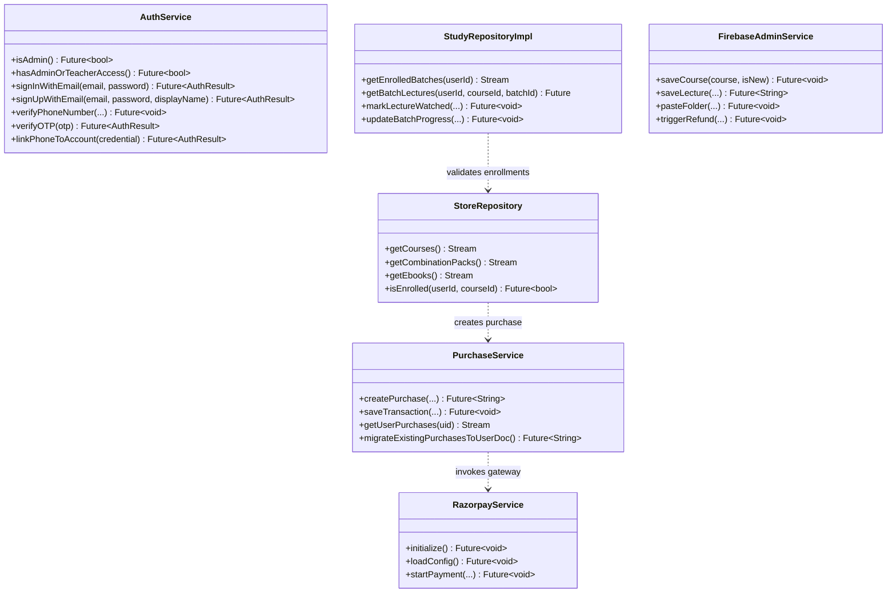
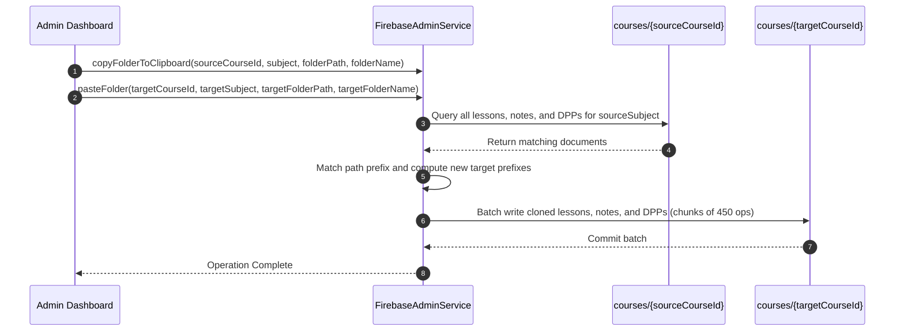

# Eduverse API Specifications & Architecture Reference

This document provides a comprehensive technical reference for the backend and client-side service APIs powering **The Eduverse** educational platform. It details all Firebase Cloud Functions (v1 TypeScript runtime) and client-side Dart service repositories, including request/response schemas, transactional state machines, Firestore/RTDB read-write matrices, security constraints, and error handling mechanisms.

---

## Table of Contents

1. [Architecture & System Topology](#1-architecture--system-topology)
2. [Firebase Cloud Functions API](#2-firebase-cloud-functions-api)
   - [2.1 onPurchaseCreate (Transactional Purchase Processor)](#21-onpurchasecreate-transactional-purchase-processor)
   - [2.2 enrollStudent (Admin Manual Enrollment)](#22-enrollstudent-admin-manual-enrollment)
   - [2.3 webhookPaymentUpdate (Razorpay Webhook Endpoint)](#23-webhookpaymentupdate-razorpay-webhook-endpoint)
   - [2.4 generateInvoice (Invoice PDF Retrieval)](#24-generateinvoice-invoice-pdf-retrieval)
   - [2.5 setAdminRole (RBAC Custom Claims Provisioner)](#25-setadminrole-rbac-custom-claims-provisioner)
   - [2.6 removeAdminRole (Revoke Admin Privileges)](#26-removeadminrole-revoke-admin-privileges)
   - [2.7 incrementLessonView (Atomic View Counter)](#27-incrementlessonview-atomic-view-counter)
   - [2.8 backupFirestoreToStorage (Automated DR Backup)](#28-backupfirestoretostorage-automated-dr-backup)
   - [2.9 onNotificationCreate (Multicast Push Dispatcher)](#29-onnotificationcreate-multicast-push-dispatcher)
   - [2.10 sendUpdateReminders (Version Hygiene Engine)](#210-sendupdatereminders-version-hygiene-engine)
   - [2.11 refundPurchase (Payment Gateway Refund Processor)](#211-refundpurchase-payment-gateway-refund-processor)
   - [2.12 onLiveViewerDisconnect (RTDB Presence Sync - Optional)](#212-onliveviewerdisconnect-rtdb-presence-sync---optional)
3. [Client-Side Service APIs](#3-client-side-service-apis)
   - [3.1 AuthService (`lib/core/firebase/auth_service.dart`)](#31-authservice)
   - [3.2 PurchaseService (`lib/core/firebase/purchase_service.dart`)](#32-purchaseservice)
   - [3.3 CartService (`lib/core/firebase/cart_service.dart`)](#33-cartservice)
   - [3.4 PromoCodeService (`lib/core/firebase/promo_code_service.dart`)](#34-promocodeservice)
   - [3.5 QuizStatsService (`lib/core/firebase/quiz_stats_service.dart`)](#35-quizstatsservice)
   - [3.6 WatchStatsService (`lib/core/firebase/watch_stats_service.dart`)](#36-watchstatsservice)
   - [3.7 RazorpayService (`lib/core/firebase/razorpay_service.dart`)](#37-razorpayservice)
   - [3.8 BookmarkService (`lib/core/firebase/bookmark_service.dart`)](#38-bookmarkservice)
   - [3.9 LiveViewerService (`lib/core/firebase/live_viewer_service.dart`)](#39-liveviewerservice)
   - [3.10 NotificationRepository (`lib/core/notifications/notification_repository.dart`)](#310-notificationrepository)
   - [3.11 StoreRepository (`lib/store/services/store_repository.dart`)](#311-storerepository)
   - [3.12 FeedRepository (`lib/feed/repository/feed_repository.dart`)](#312-feedrepository)
   - [3.13 StudyRepositoryImpl (`lib/study/data/repositories/study_repository_impl.dart`)](#313-studyrepositoryimpl)
   - [3.14 FirebaseAdminService (`lib/admin/services/firebase_admin_service.dart`)](#314-firebaseadminservice)
   - [3.15 CommunityService (`lib/admin/services/community_service.dart`)](#315-communityservice)
   - [3.16 TestSeriesService (`lib/admin/services/test_series_service.dart`)](#316-testseriesservice)
4. [Cross-Cutting Concerns & Security Model](#4-cross-cutting-concerns--security-model)

---

## 1. Architecture & System Topology

The Eduverse backend leverages serverless Firebase infrastructure integrated with native Flutter mobile clients and admin portals. The ecosystem utilizes:
- **Cloud Firestore**: Primary NoSQL document database for hierarchical educational assets, user profiles, and transactional records.
- **Firebase Authentication**: Custom Claims-based RBAC (`superadmin`, `admin`, `content_manager`, `support`, `teacher`, `student`).
- **Cloud Functions for Firebase**: Event-driven automation, external gateway integration (Razorpay), scheduled crons, and background processors.
- **Firebase Cloud Messaging (FCM)**: Batched multicast push notifications targeted by topic, user status, or course enrollment.
- **Firebase Realtime Database (RTDB)**: Ephemeral presence detection with connection lifecycle hooks (`onDisconnect`).
- **Cloud Storage for Firebase**: Encrypted file storage for video assets, DPP/Notes PDFs, promotional banners, and automated database backups.



---

## 2. Firebase Cloud Functions API

Source implementation located at [`functions/src/index.ts`](file:///home/himanshu/codes/eduverse/functions/src/index.ts).

### 2.1 onPurchaseCreate (Transactional Purchase Processor)

- **Type**: Firestore Background Trigger (`onCreate`)
- **Path**: `purchases/{purchaseId}`
- **Runtime**: Node.js 18 / TypeScript (`firebase-functions/v1`)
- **Concurrency / Reliability**: Idempotent document creation handler with built-in `db.runTransaction` execution.

#### Purpose
Executes end-to-end fulfillment when a purchase document is created. It resolves bundled items (such as combination packs expanding into multiple courses), deduplicates target enrollments, decrements remaining seat capacity on individual courses, creates active enrollment records, writes immutable audit log entries, and transitions the purchase status to `success` or `failed`.

#### Transactional Lifecycle & Combo Pack Expansion Flow



#### Input Document Schema
```typescript
interface PurchaseDocument {
  purchaseId: string;
  userId: string;
  amount: number;
  paymentId?: string;
  paymentMethod: 'razorpay' | 'stripe' | 'manual' | string;
  status: 'pending' | 'success' | 'completed' | 'failed';
  items: Array<{
    courseId?: string;
    batchId?: string;
    testSeriesId?: string;
    ebookId?: string;
    combinationPackId?: string;
    title?: string;
    price?: number;
  }>;
  gstNumber?: string;
  promoCode?: string;
  discountAmount?: number;
  createdAt: FirebaseFirestore.Timestamp;
  timestamp: FirebaseFirestore.Timestamp;
}
```

#### Side Effects & Database Operations
1. **Reads**:
   - `combination_packs/{combinationPackId}`: Fetches `courses` array.
   - `courses/{courseId}`: Reads `seatsLeft` and validates course existence.
2. **Writes (Atomic Transaction)**:
   - `courses/{courseId}`: Decrements `seatsLeft` (`seatsLeft - 1`).
   - `enrollments/{userId}_{courseId}`: Creates document:
     ```typescript
     {
       userId: string,
       courseId: string,
       enrolledAt: FieldValue.serverTimestamp(),
       status: 'active',
       purchaseId: string,
       combinationPackId: string | null
     }
     ```
   - `audits/{autoId}`: Creates document:
     ```typescript
     {
       action: "system_enroll",
       entityType: "enrollment",
       entityId: `${userId}_${courseId}`,
       timestamp: FieldValue.serverTimestamp(),
       details: {
         purchaseId: string,
         combinationPackId: string | null
       }
     }
     ```
3. **Final Mutation**:
   - Updates `purchases/{purchaseId}` status to `'success'` (or `'failed'` with error description on caught exceptions).

---

### 2.2 enrollStudent (Admin Manual Enrollment)

- **Type**: HTTPS Callable (`functions.https.onCall`)
- **Authentication**: Required (`context.auth`).
- **Authorization**: Custom claim `role === 'admin' || role === 'superadmin'`.

#### Purpose
Enables administrators to manually grant course access to students bypassing standard payment gateways.

#### Request Payload
```typescript
interface EnrollStudentRequest {
  userId: string;
  courseId: string;
  batchId?: string;
}
```

#### Response Payload
```typescript
interface EnrollStudentResponse {
  success: boolean;
  message?: string;
}
```

#### Error Handling
- `permission-denied`: Caller does not possess admin or superadmin claims.
- `invalid-argument`: Missing `userId` or `courseId`.
- `internal`: Firestore transactional failure.

---

### 2.3 webhookPaymentUpdate (Razorpay Webhook Endpoint)

- **Type**: HTTPS Request (`functions.https.onRequest`)
- **Method**: `POST`
- **Path**: `/webhookPaymentUpdate`
- **Authentication**: Webhook payload validation.

#### Purpose
Listens for asynchronous payment status callbacks dispatched by the Razorpay payment gateway to update purchase transaction records.

#### Request Body
```json
{
  "purchaseId": "PURCHASE_DOC_ID_12345",
  "status": "success"
}
```

#### Response Body
```json
{
  "received": true
}
```

#### Side Effects
- Mutates `purchases/{purchaseId}` with `{ status: req.body.status }`.

---

### 2.4 generateInvoice (Invoice PDF Retrieval)

- **Type**: HTTPS Callable (`functions.https.onCall`)
- **Authentication**: Required (`context.auth`).

#### Purpose
Generates or retrieves a digitally signed tax invoice PDF stored on Google Cloud Storage for a verified purchase transaction.

#### Request Payload
```typescript
interface GenerateInvoiceRequest {
  purchaseId: string;
}
```

#### Response Payload
```typescript
interface GenerateInvoiceResponse {
  url: string; // e.g. "https://storage.googleapis.com/<bucket>/invoice_123.pdf"
}
```

---

### 2.5 setAdminRole (RBAC Custom Claims Provisioner)

- **Type**: HTTPS Callable (`functions.https.onCall`)
- **Authentication**: Required (allows first-time bootstrapping if no admin accounts exist; otherwise enforces `role === 'admin' || role === 'superadmin'`).

#### Purpose
Assigns Firebase Auth custom claims and synchronizes the user's Firestore profile role and teacher flags.

#### Role Hierarchy & Permissions
| Role | Level | Description |
| :--- | :--- | :--- |
| `superadmin` | Level 0 | Unrestricted access across system, billing, RBAC, and backups |
| `admin` | Level 1 | Full access to content, users, enrollments, refunds, and promo codes |
| `content_manager` | Level 2 | Management of courses, lectures, DPPs, quizzes, and notes |
| `support` | Level 3 | User query inspection, transaction lookups, and support tickets |
| `teacher` | Level 4 | Access to assigned course study rooms, live streaming, and community channels |
| `student` / `user` | Level 5 | Standard learner access to purchased materials and public feeds |

#### Request Payload
```typescript
interface SetAdminRoleRequest {
  uid: string;
  role?: 'superadmin' | 'admin' | 'content_manager' | 'support' | 'teacher' | 'user' | 'student';
  isTeacher?: boolean;
}
```

#### Response Payload
```typescript
interface SetAdminRoleResponse {
  success: boolean;
  message: string;
}
```

#### Side Effects
1. Executes `admin.auth().setCustomUserClaims(uid, { role: targetRole, isTeacher: targetIsTeacher })`.
2. Updates `users/{uid}` in Firestore with `{ role: targetRole, isTeacher: targetIsTeacher, updatedAt: serverTimestamp() }` via merge.
3. Appends entry to `audits` collection with action `'set_admin_role'`.

---

### 2.6 removeAdminRole (Revoke Admin Privileges)

- **Type**: HTTPS Callable (`functions.https.onCall`)
- **Authentication**: Required (`context.auth.token.role === 'admin' || 'superadmin'`).

#### Purpose
Revokes elevated administrative claims and resets a user to standard `student` status.

#### Request Payload
```typescript
interface RemoveAdminRoleRequest {
  uid: string;
}
```

#### Response Payload
```typescript
interface RemoveAdminRoleResponse {
  success: boolean;
  message: string;
}
```

#### Side Effects
1. Resets Auth custom claims to `{ role: 'student' }`.
2. Updates `users/{uid}` in Firestore to `{ role: 'student', updatedAt: serverTimestamp() }`.
3. Creates audit record with action `'remove_admin_role'`.

---

### 2.7 incrementLessonView (Atomic View Counter)

- **Type**: HTTPS Callable (`functions.https.onCall`)
- **Authentication**: Public / Authenticated.

#### Purpose
Atomically increments lesson engagement counters in Firestore without read-before-write race conditions.

#### Request Payload
```typescript
interface IncrementLessonViewRequest {
  courseId: string;
  lessonId: string;
}
```

#### Response Payload
```typescript
interface IncrementLessonViewResponse {
  success: boolean;
}
```

#### Side Effects
- Mutates `courses/{courseId}/lessons/{lessonId}` with `{ views: FieldValue.increment(1) }`.

---

### 2.8 backupFirestoreToStorage (Automated DR Backup)

- **Type**: Scheduled Pub/Sub
- **Schedule**: `every 24 hours`
- **Target Bucket**: `gs://<projectId>-backups`

#### Purpose
Executes a server-side managed export of all Cloud Firestore collections using the Google Cloud Firestore Admin Client API (`admin.firestore.v1.FirestoreAdminClient`).

#### Process
1. Resolves GCP Project ID from environment variables (`GCP_PROJECT` or `GCLOUD_PROJECT`).
2. Constructs database identifier: `projects/<projectId>/databases/(default)`.
3. Dispatches `exportDocuments` with `collectionIds: []` to trigger full database snapshot.

---

### 2.9 onNotificationCreate (Multicast Push Dispatcher)

- **Type**: Firestore Background Trigger (`onCreate`)
- **Path**: `notifications/{notificationId}`

#### Purpose
Listens for new notification records written to Firestore and dispatches batched Firebase Cloud Messaging (FCM) push messages to enrolled users or global app subscribers.

```mermaid
graph TD
    A[Notification Created: notifications/{id}] --> B{Has courseId?}
    B -->|Yes| C[Query users where enrolledCourses array-contains courseId]
    B -->|No| D[Query users where fcmToken > '']
    C --> E[Extract FCM Device Tokens]
    D --> E
    E --> F[Chunk Tokens into Batches of <= 500]
    F --> G[messaging.sendEachForMulticast]
    G --> H[Log Success / Failure Metrics]
```

#### Multicast Message Payload Structure
- **Notification**: `{ title, body, imageUrl }`
- **Data Attributes**: `{ targetType, targetId, notificationId }`
- **Android Config**: High Priority, `channelId: "eduverse_channel"`.
- **APNs Config**: Sound `"default"`, `badge: 1`.
- **Batching Threshold**: Max 500 tokens per FCM SDK call (`sendEachForMulticast`).

---

### 2.10 sendUpdateReminders (Version Hygiene Engine)

- **Type**: Scheduled Pub/Sub
- **Schedule**: `every 24 hours`

#### Purpose
Identifies active users operating on outdated application builds and delivers high-priority FCM push reminders prompting an immediate app update.

#### Operational Logic
1. Reads latest release string from `app_config/version` (`latestVersion`).
2. Queries all users in `users` having non-empty `fcmToken`.
3. Filters users where `userDoc.appVersion !== latestVersion`.
4. Dispatches batched multicast push notifications (`targetType: 'update'`, `targetId: latestVersion`).

---

### 2.11 refundPurchase (Payment Gateway Refund Processor)

- **Type**: HTTPS Callable (`functions.https.onCall`)
- **Authentication**: Required (`role === 'admin' || role === 'superadmin'`).

#### Purpose
Facilitates secure administrative payment refunds. It dynamically fetches active Razorpay API credentials from Firestore configuration, validates payment eligibility, executes the refund via Razorpay's REST API (converting the amount to paise), and logs the operation.

#### Request Payload
```typescript
interface RefundPurchaseRequest {
  purchaseId: string;
}
```

#### Response Payload
```typescript
interface RefundPurchaseResponse {
  success: boolean;
  refundId: string; // Razorpay refund ID, e.g. "rfnd_NX12345ABC"
}
```

#### Security & Validation Steps
1. Validates caller claims against admin / superadmin authorization.
2. Checks `purchases/{purchaseId}` existence and ensures `status !== 'refunded'`.
3. Reads `config/razorpay` to extract `keyId` and `keySecret`.
4. Instantiates `Razorpay` client dynamically.
5. Invokes `razorpay.payments.refund(paymentId, { amount: Math.round(amount * 100), notes: { refundedBy, reason } })`.

---

### 2.12 onLiveViewerDisconnect (RTDB Presence Sync - Optional)

- **Type**: Realtime Database Event Trigger (`onDelete`)
- **Path**: `live_viewers/{sessionKey}/{userId}`
- **Status**: Standby (activate upon provisioning RTDB instance).

#### Purpose
Handles ungraceful client terminations (app kills, crashes, socket timeouts). When RTDB detects client disconnection and cleans up the node via `onDisconnect().remove()`, this function executes to decrement `viewerCount` in Firestore on `courses/{courseId}/live_classes/{liveClassId}`.

---

## 3. Client-Side Service APIs

The Flutter application interacts with Firebase through dedicated repositories and services residing under `lib/`.



---

### 3.1 AuthService

- **File Path**: [`lib/core/firebase/auth_service.dart`](file:///home/himanshu/codes/eduverse/lib/core/firebase/auth_service.dart)
- **Primary Dependencies**: `FirebaseAuth`, `cloud_firestore`, `UserService`
- **Target Collections**: `users`

#### Methods & Type Signatures

```dart
class AuthService {
  Stream<User?> get authStateChanges;
  User? get currentUser;

  /// Checks if current user is admin/superadmin.
  /// Detects claims mismatch with Firestore and auto-refreshes ID token if needed.
  Future<bool> isAdmin();

  /// Checks if current user has admin, superadmin, or teacher access.
  Future<bool> hasAdminOrTeacherAccess();

  /// Sign in with email and password
  Future<AuthResult> signInWithEmail({
    required String email,
    required String password,
  });

  /// Register new user and initialize Firestore profile in users/{uid}
  Future<AuthResult> signUpWithEmail({
    required String email,
    required String password,
    String? displayName,
  });

  /// Trigger password reset email
  Future<AuthResult> resetPassword(String email);

  /// Initiate Phone OTP verification
  Future<void> verifyPhoneNumber({
    required String phoneNumber,
    required Function(String verificationId) onCodeSent,
    required Function(String error) onError,
    required Function(PhoneAuthCredential credential) onAutoVerified,
  });

  /// Complete Phone OTP verification and sign in
  Future<AuthResult> verifyOTP(String otp);

  /// Link phone credential to an existing user account
  Future<AuthResult> linkPhoneToAccount(PhoneAuthCredential credential);

  /// Update email with verification step
  Future<AuthResult> updateEmail(String newEmail);

  /// Update verified phone number
  Future<AuthResult> updatePhoneNumber(PhoneAuthCredential credential, String phoneNumber);

  /// Re-authenticate user before sensitive security operations
  Future<AuthResult> reauthenticateWithEmail(String email, String password);

  /// Check if user document profile exists in Firestore
  Future<bool> userProfileExists(String uid);

  /// Sign out
  Future<void> signOut();
}
```

---

### 3.2 PurchaseService

- **File Path**: [`lib/core/firebase/purchase_service.dart`](file:///home/himanshu/codes/eduverse/lib/core/firebase/purchase_service.dart)
- **Primary Dependencies**: `FirebaseFirestore`
- **Target Collections**: `purchases`, `users/{uid}/enrolledCourses`, `users/{uid}/purchasedEbooks`, `users/{uid}/purchasedTestSeries`, `users/{uid}/transactions`, `courses`, `combination_packs`

#### Transactional Purchase Creation

```dart
class PurchaseService {
  /// Atomically commits purchase records, expands combination packs,
  /// creates subcollection enrollments, and updates root user arrays.
  Future<String> createPurchase({
    required String uid,
    required double amount,
    required String paymentId,
    required List<Map<String, dynamic>> items,
    String method = 'stripe',
    String status = 'completed',
    String? gstNumber,
    String? promoCode,
    double? discountAmount,
  });

  /// Adds an immutable entry to users/{uid}/transactions
  Future<void> saveTransaction({
    required String uid,
    required String orderId,
    required String productTitle,
    required double amount,
    required String status,
    required String paymentMethod,
  });

  /// Real-time stream of user transactions ordered by date descending
  Stream<List<Map<String, dynamic>>> getTransactionsStream(String uid);

  /// Real-time stream of user purchase documents
  Stream<List<Map<String, dynamic>>> getUserPurchases(String uid);

  /// Backfill migration utility: syncs legacy purchase documents to user enrollment arrays
  Future<String> migrateExistingPurchasesToUserDoc();
}
```

---

### 3.3 CartService

- **File Path**: [`lib/core/firebase/cart_service.dart`](file:///home/himanshu/codes/eduverse/lib/core/firebase/cart_service.dart)
- **Target Collections**: `users/{uid}/cart`

#### Methods & Type Signatures

```dart
class CartService {
  /// Add item to cart at users/{uid}/cart/{courseId}
  Future<void> addToCart(String uid, Map<String, dynamic> item);

  /// Remove specific item from cart
  Future<void> removeFromCart(String uid, String courseId);

  /// Delete all items in user's cart subcollection
  Future<void> clearCart(String uid);

  /// Stream of active cart items
  Stream<List<Map<String, dynamic>>> getCartItems(String uid);
}
```

---

### 3.4 PromoCodeService

- **File Path**: [`lib/core/firebase/promo_code_service.dart`](file:///home/himanshu/codes/eduverse/lib/core/firebase/promo_code_service.dart)
- **Target Collections**: `config/promo_codes/codes/{code}`

#### Promo Code Validation & Management

```dart
class PromoCodeService {
  /// Validates a promotional code against current cart items, expiry dates,
  /// min order thresholds, and usage limits. Returns proportional discount distribution.
  Future<PromoCodeResult> validatePromoCode(
    String code,
    List<PromoCartItem> cartItems,
  );

  /// Atomically increments usedCount on promo code document
  Future<void> incrementUsage(String code);

  /// Admin: Stream all promo codes
  Stream<List<PromoCode>> getAllPromoCodes();

  /// Admin: Create promo code
  Future<void> createPromoCode(PromoCode promoCode);

  /// Admin: Update promo code
  Future<void> updatePromoCode(PromoCode promoCode);

  /// Admin: Delete promo code
  Future<void> deletePromoCode(String code);
}
```

---

### 3.5 QuizStatsService

- **File Path**: [`lib/core/firebase/quiz_stats_service.dart`](file:///home/himanshu/codes/eduverse/lib/core/firebase/quiz_stats_service.dart)
- **Target Collections**: `users/{uid}/quiz_attempts`, `users/{uid}/stats/quiz`

#### Methods & Aggregates

```dart
class QuizStatsService {
  /// Writes individual quiz attempt record and updates aggregate stats via transaction
  Future<void> saveQuizAttempt({
    required String quizId,
    required String quizTitle,
    required int questionsAttempted,
    required int correctAnswers,
    required bool completed,
    required String source, // 'batch' | 'feed'
    int? wrongAnswers,
    int? unattemptedCount,
    double? percentage,
    String? categoryLabel,
  });

  /// Retrieve quiz attempt logs within a specific date range
  Future<List<Map<String, dynamic>>> getQuizAttemptsInRange(DateTime start, DateTime end);

  /// Retrieve all distinct quiz category labels attempted by user
  Future<List<String>> getDistinctCategories();

  /// Stream user's aggregate quiz statistics (questionsAttempted, quizzesCompleted, etc.)
  Stream<Map<String, dynamic>> getQuizStatsStream();
}
```

---

### 3.6 WatchStatsService

- **File Path**: [`lib/core/firebase/watch_stats_service.dart`](file:///home/himanshu/codes/eduverse/lib/core/firebase/watch_stats_service.dart)
- **Target Collections**: `users/{uid}/watch_sessions`, `users/{uid}/stats/watch`

#### Video Watch Analytics

```dart
class WatchStatsService {
  /// Records a video viewing session and transactionally updates total watch time aggregates
  Future<void> recordWatchTime({
    required String lectureId,
    required String lectureTitle,
    double? watchedMinutes,
    int? seconds,
    String? subjectName,
    String? courseId,
    String? batchId,
  });

  /// Stream of user's aggregate watch metrics (totalMinutes, sessionsCount)
  Stream<Map<String, dynamic>> getWatchStatsStream();

  /// Query watch sessions inside a datetime boundary
  Future<List<Map<String, dynamic>>> getWatchSessionsInRange(DateTime start, DateTime end);
}
```

---

### 3.7 RazorpayService

- **File Path**: [`lib/core/firebase/razorpay_service.dart`](file:///home/himanshu/codes/eduverse/lib/core/firebase/razorpay_service.dart)
- **Target Collections**: `config/razorpay`

#### Gateway Controller Interface

```dart
class RazorpayService {
  RazorpayConfig? get config;

  /// Initializes Razorpay Flutter event handlers and fetches credentials from Firestore
  Future<void> initialize();

  /// Loads configuration document from config/razorpay
  Future<void> loadConfig();

  /// Admin: Updates Razorpay key credentials and modes
  Future<void> saveConfig(RazorpayConfig config);

  /// Streams Razorpay configuration state
  Stream<RazorpayConfig?> watchConfig();

  /// Launches native Razorpay checkout UI with prefilled customer data & notes
  Future<void> startPayment({
    required double amount,
    required String orderId,
    required String customerName,
    required String customerEmail,
    required String customerPhone,
    String? customerAddress,
    String? gstNumber,
    String? promoCode,
    String? description,
    required void Function(PaymentResult) onComplete,
  });

  /// Cleans up event listeners
  void dispose();
}
```

---

### 3.8 BookmarkService

- **File Path**: [`lib/core/firebase/bookmark_service.dart`](file:///home/himanshu/codes/eduverse/lib/core/firebase/bookmark_service.dart)
- **Target Collections**: `users/{uid}/bookmarks/{itemId}`

#### Methods & Type Signatures

```dart
class BookmarkService {
  /// Toggles bookmark state (creates doc if absent, deletes if present). Returns updated state.
  Future<bool> toggleBookmark(BookmarkItem item);

  /// Returns true if item is currently bookmarked
  Future<bool> isBookmarked(String itemId);

  /// Real-time stream of item bookmark status
  Stream<bool> isBookmarkedStream(String itemId);

  /// Stream of all user bookmarks ordered by dateAdded descending
  Stream<List<BookmarkItem>> getBookmarksStream();

  /// Deletes a bookmark explicitly
  Future<void> removeBookmark(String itemId);
}
```

---

### 3.9 LiveViewerService

- **File Path**: [`lib/core/firebase/live_viewer_service.dart`](file:///home/himanshu/codes/eduverse/lib/core/firebase/live_viewer_service.dart)
- **Firestore Collections**: `courses/{courseId}/live_classes/{liveClassId}`
- **RTDB Nodes**: `live_viewers/{courseId}_{liveClassId}/{userId}`

#### Presence & Concurrency Tracking

```dart
class LiveViewerService {
  /// Increments Firestore viewerCount, creates RTDB presence node, and establishes onDisconnect cleanup
  Future<void> joinLive(String courseId, String batchId, String liveClassId);

  /// Cancels RTDB onDisconnect hook, removes RTDB node, and decrements Firestore viewerCount
  Future<void> leaveLive(String courseId, String batchId, String liveClassId);

  /// Real-time stream of live viewer counts (clamped to minimum 0)
  Stream<int> viewerCountStream(String courseId, String batchId, String liveClassId);
}
```

---

### 3.10 NotificationRepository

- **File Path**: [`lib/core/notifications/notification_repository.dart`](file:///home/himanshu/codes/eduverse/lib/core/notifications/notification_repository.dart)
- **Target Collections**: `notifications`, `users/{uid}`

#### Methods & Dispatchers

```dart
class NotificationRepository {
  /// Streams notifications relevant to user (combines global notices and enrolled course notices)
  Stream<List<UserNotification>> getUserNotifications();

  /// Streams count of unread notifications for current user
  Stream<int> getUnreadCount();

  /// Marks single notification as read in user document
  Future<void> markAsRead(String notificationId);

  /// Marks list of notification IDs as read
  Future<void> markAllAsRead(List<String> notificationIds);

  /// Hides notification for the current user
  Future<void> deleteForUser(String notificationId);

  /// Creates a global notification document (triggers FCM Cloud Function)
  Future<void> createGlobalNotification({
    required String title,
    required String body,
    required NotificationTargetType targetType,
    required String targetId,
    String? imageUrl,
    String? courseId,
    String? batchId,
  });

  /// Creates a course-specific notification document
  Future<void> createCourseNotification({
    required String title,
    required String body,
    required NotificationTargetType targetType,
    required String targetId,
    required String courseId,
    String? imageUrl,
  });

  /// Batched creation of notifications across multiple courses
  Future<void> createMultipleCourseNotifications({
    required String title,
    required String body,
    required NotificationTargetType targetType,
    required String targetId,
    required List<String> targetCourses,
    String? imageUrl,
  });

  /// Admin: Stream all system notifications
  Stream<List<NotificationModel>> getAllNotifications();

  /// Admin: Permanently delete notification document
  Future<void> deleteNotification(String id);
}
```

---

### 3.11 StoreRepository

- **File Path**: [`lib/store/services/store_repository.dart`](file:///home/himanshu/codes/eduverse/lib/store/services/store_repository.dart)
- **Target Collections**: `courses`, `combination_packs`, `ebooks`, `purchases`, `users/{uid}/enrolledCourses`, `users/{uid}/purchasedEbooks`

#### Store Catalog Queries

```dart
class StoreRepository {
  /// Streams published courses, filtering out courses already enrolled by the authenticated user
  Stream<List<Course>> getCourses();

  /// Streams all active combination packs
  Stream<List<CombinationPack>> getCombinationPacks();

  /// Streams active e-books with user ownership flags
  Stream<List<Ebook>> getEbooks();

  /// Writes purchase document directly to purchases collection
  Future<void> createPurchase(Purchase purchase);

  /// Queries user purchases ordered by timestamp descending
  Future<List<Purchase>> getPurchases(String userId);

  /// Extracts enrolled course IDs from successful purchase documents
  Future<List<String>> getEnrolledCourseIds(String userId);

  /// Multi-tier enrollment check (subcollection -> composite key -> purchase history)
  Future<bool> isEnrolled(String userId, String courseId, [String batchId = '']);

  /// Real-time stream of user purchases
  Stream<List<Purchase>> watchUserPurchases(String userId);
}
```

---

### 3.12 FeedRepository

- **File Path**: [`lib/feed/repository/feed_repository.dart`](file:///home/himanshu/codes/eduverse/lib/feed/repository/feed_repository.dart)
- **Target Collections**: `feed`, `feed/{id}/comments`, `feed/{id}/likes`, `feed/{id}/answers`, `users/{uid}/bookmarks`

#### Methods & Interactions

```dart
class FeedRepository {
  /// Stream public feed items filtered by ContentType (currentAffairs, articles, quizzes, videos, jobs)
  Stream<List<FeedItem>> getFeedItems({ContentType? type, int? limit});

  /// Fetch single feed item by ID
  Future<FeedItem?> getFeedItem(String id);

  /// Create feed item with optional push notification dispatch
  Future<void> addFeedItem(FeedItem item, {required FeedNotificationPolicy notificationPolicy});

  /// Admin: Stream all feed items (including drafts and private items)
  Stream<List<FeedItem>> getAllFeedItems();

  /// Update existing feed item
  Future<void> updateFeedItem(FeedItem item);

  /// Delete feed item
  Future<void> deleteFeedItem(String id);

  /// Atomically increments viewCount on feed document
  Future<void> incrementViewCount(String feedId);

  /// Stream user's like state on a feed item
  Stream<bool> isLikedStream(String feedId, String userId);

  /// Transactionally toggles like status and increments/decrements likesCount
  Future<void> toggleLike(String feedId, String userId);

  /// Stream comments on a feed item ordered by createdAt descending
  Stream<List<Comment>> getComments(String feedId);

  /// Transactionally adds a comment and increments commentsCount
  Future<void> addComment(String feedId, Comment comment);

  /// Stream user bookmark status for a feed item
  Stream<bool> isBookmarkedStream(String feedId, String userId);

  /// Toggles bookmark entry in users/{uid}/bookmarks/{feedId}
  Future<void> toggleBookmark(String feedId, String userId);

  /// Submit subjective answer writing response to feed/{feedId}/answers/{userId}
  Future<void> submitAnswer(String feedId, String userId, String answerText, int timeTakenSeconds);
}
```

---

### 3.13 StudyRepositoryImpl

- **File Path**: [`lib/study/data/repositories/study_repository_impl.dart`](file:///home/himanshu/codes/eduverse/lib/study/data/repositories/study_repository_impl.dart)
- **Target Collections**: `courses/{id}/lessons`, `courses/{id}/live_classes`, `courses/{id}/notes`, `courses/{id}/dpps`, `courses/{id}/quizzes`, `courses/{id}/planner`, `courses/{id}/recorded_batches`, `free_live_classes`, `topics`, `users/{uid}/courseProgress`, `users/{uid}/courseBookmarks`

#### Study Room & Content Delivery

```dart
class StudyRepositoryImpl implements IStudyRepository {
  /// Stream enrolled study batches (courses & combo packs). Admins receive all catalog items.
  Stream<List<StudyBatch>> getEnrolledBatches(String userId);

  /// Fetch lessons for course with user watched-progress status
  Future<List<StudyLecture>> getBatchLectures(String userId, String courseId, batchId);

  /// Real-time stream of course lessons
  Stream<List<StudyLecture>> getBatchLecturesStream(String userId, String courseId, String batchId);

  /// Marks lecture as watched and recalculates course completion percentage
  Future<void> markLectureWatched(String userId, String courseId, String batchId, String lectureId, bool isWatched);

  /// Recalculates course progress percentage and commits to users/{uid}/courseProgress/{courseId}
  Future<void> updateBatchProgress(String userId, String courseId, String batchId);

  /// Fetch quizzes for course
  Future<List<StudyQuiz>> getBatchQuizzes(String courseId, String batchId);

  /// Fetch notes for course
  Future<List<StudyNote>> getBatchNotes(String courseId, String batchId);

  /// Fetch planner / timetable items for course
  Future<List<StudyPlannerItem>> getBatchPlanner(String courseId, String batchId);

  /// Fetch daily practice problems (DPPs)
  Future<List<StudyDpp>> getBatchDpps(String courseId, String batchId);

  /// Fetch live classes for course
  Future<List<StudyLiveClass>> getBatchLiveClasses(String courseId, String batchId);

  /// Fetch free public live classes
  Future<List<StudyLiveClass>> getFreeLiveClasses();

  /// Stream user bookmarked batches
  Stream<bool> isBatchBookmarked(String userId, String batchId);

  /// Toggle study batch bookmark
  Future<void> toggleBatchBookmark(String userId, String batchId);

  /// Fetch recorded batch variations within a course
  Future<List<StudyRecordedBatch>> getRecordedBatchesForCourse(String courseId);

  /// Fetch lessons inside a recorded batch
  Future<List<StudyLecture>> getRecordedBatchLectures(String userId, String courseId, String batchId);

  /// Fetch notes inside a recorded batch
  Future<List<StudyNote>> getRecordedBatchNotes(String courseId, String batchId);

  /// Fetch DPPs inside a recorded batch
  Future<List<StudyDpp>> getRecordedBatchDpps(String courseId, String batchId);

  /// Fetch Quizzes inside a recorded batch
  Future<List<StudyQuiz>> getRecordedBatchQuizzes(String courseId, String batchId);
}
```

---

### 3.14 FirebaseAdminService

- **File Path**: [`lib/admin/services/firebase_admin_service.dart`](file:///home/himanshu/codes/eduverse/lib/admin/services/firebase_admin_service.dart)
- **Target Collections**: `courses`, `users`, `purchases`, `combination_packs`, `ebooks`, `audits`, `quiz_pool`, `recurring_rules`

#### Key Operational Categories

#### A. Course & Content CRUD
- `saveCourse(AdminCourse course, {bool isNew}) → Future<void>`: Creates or updates course metadata.
- `deleteCourse(String courseId) → Future<void>`: Sets `isDeleted: true` (soft-delete).
- `permanentlyDeleteCourse(String courseId) → Future<void>`: Deletes course and recursively cleans lessons, notes, DPPs, quizzes, and live classes.
- `saveLecture(...) → Future<String>`: Saves lecture under `courses/{courseId}/lessons/{lectureId}`.
- `saveCourseNote(...)`, `saveCourseDpp(...)`, `saveCoursePlannerItem(...)`, `saveCourseQuiz(...)`: Dedicated subcollection CRUD operations.

#### B. Recursive Tree Deep Clone & Move Engine
Enables copying entire hierarchical chapter/subject folders across courses, cloning nested lessons, notes, and DPPs with automated URL rewrites and index remapping.



#### Recursive Folder Operations
- `copyFolderToClipboard({courseId, subject, folderPath, folderName})`: Populates in-memory clipboard.
- `pasteFolder({sourceCourseId, sourceSubject, sourceFolderPath, sourceFolderName, targetCourseId, targetSubject, targetFolderPath, targetFolderName})`: Recursive batch clone across courses.
- `pasteSubject({sourceCourseId, sourceSubject, targetCourseId, targetSubject})`: Deep-clones all content under an entire subject hierarchy.
- `renameFolderPrefix({courseId, subject, oldPrefix, newPrefix})`: Recursively updates chapter paths for all nested lessons, notes, and DPPs.
- `deleteFolderRecursive({courseId, subject, folderPath, folderName})`: Recursively deletes folder node and all child lessons, notes, and DPPs.

#### C. User & Teacher Administration
- `getUsers() → Stream<List<AdminUser>>`, `searchUsers(query)`, `getUsersByRole(role)`
- `updateUserRole(userId, newRole) → Future<void>`
- `setTeacherFlag(userId, isTeacher) → Future<void>`
- `assignTeacherToCourse(teacherId, courseId, batchId, subjects) → Future<void>`
- `manualEnrollUser(userId, courseId, batchId) → Future<void>`
- `manualUnenrollUser(userId, enrollmentId) → Future<void>`
- `triggerRefund(purchaseId, {unenrollUser}) → Future<void>`: Calls Cloud Function `refundPurchase` and optionally removes enrollment records.

---

### 3.15 CommunityService

- **File Path**: [`lib/admin/services/community_service.dart`](file:///home/himanshu/codes/eduverse/lib/admin/services/community_service.dart)
- **Target Collections**: `communities`, `communities/{id}/posts`, `communities/{id}/posts/{postId}/replies`

#### Methods & Type Signatures

```dart
class CommunityService {
  /// Retrieves or creates unique community node for a (teacherId, subjectName) pair
  Future<Community> getOrCreateCommunity({
    required String teacherId,
    required String teacherName,
    required String subjectName,
    required List<String> courseIds,
  });

  /// Streams active communities linked to a course
  Stream<List<Community>> getCommunitiesForCourse(String courseId);

  /// Streams posts inside a community (pinned posts first, then createdAt descending)
  Stream<List<CommunityPost>> getPostsForCommunity(String communityId);

  /// Batched creation of a community post, incrementing postCount
  Future<void> createPost(String communityId, CommunityPost post);

  /// Batched deletion of post and associated replies, decrementing postCount
  Future<void> deletePost(String communityId, String postId);

  /// Streams replies for a post
  Stream<List<CommunityReply>> getRepliesForPost(String communityId, String postId);

  /// Creates reply; if author is teacher, automatically sets post isAnswered = true
  Future<void> createReply(String communityId, String postId, CommunityReply reply);
}
```

---

### 3.16 TestSeriesService

- **File Path**: [`lib/admin/services/test_series_service.dart`](file:///home/himanshu/codes/eduverse/lib/admin/services/test_series_service.dart)
- **Target Collections**: `test_series`, `test_series/{id}/tests`

#### Methods & Type Signatures

```dart
class TestSeriesService {
  /// Stream all test series packages
  Stream<List<AdminTestSeries>> getTestSeriesList();

  /// Create new test series package
  Future<String> createTestSeries(AdminTestSeries ts);

  /// Update existing test series package
  Future<void> updateTestSeries(AdminTestSeries ts);

  /// Deletes test series and deletes all nested tests in subcollection
  Future<void> deleteTestSeries(String id);

  /// Links a test series to a course document
  Future<void> linkToCourse(String tsId, LinkedCourse course);

  /// Unlinks test series from course
  Future<void> unlinkFromCourse(String tsId, String courseId);

  /// Stream test series linked to a given course
  Stream<List<AdminTestSeries>> getTestSeriesForCourse(String courseId);
}
```

---

## 4. Cross-Cutting Concerns & Security Model

### 4.1 Security Rules & Custom Claims Enforcement
- All write actions on root catalogs (`courses`, `combination_packs`, `ebooks`, `test_series`, `notifications`, `config`) require verified claims (`auth.token.role in ['admin', 'superadmin']`).
- User document subcollections (`users/{uid}/...`) are restricted to `request.auth.uid == uid` or admin claims.
- Financial transactions (`purchases/{id}`) are locked against direct client modifications; writes are mediated via `onPurchaseCreate` or admin callables.

### 4.2 Error Handling & Resilience Pattern
- **Idempotency**: Purchase processing deduplicates course arrays before generating enrollment IDs.
- **Batching Thresholds**: Firestore batch writes are capped at 450 operations per batch commit (under the 500-op platform limit).
- **Graceful Token Synchronization**: `AuthService.isAdmin()` detects discrepancies between cached JWT custom claims and Firestore document roles, automatically triggering `getIdToken(true)` to synchronize permissions transparently.
