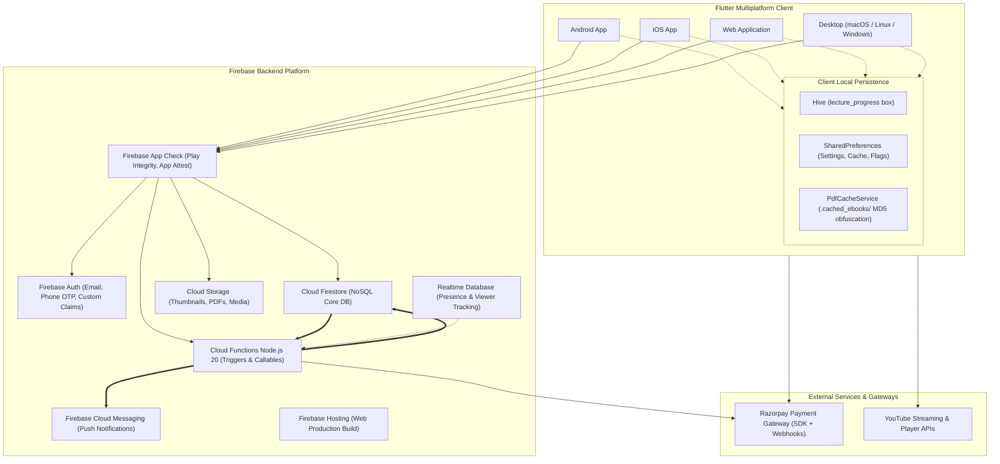
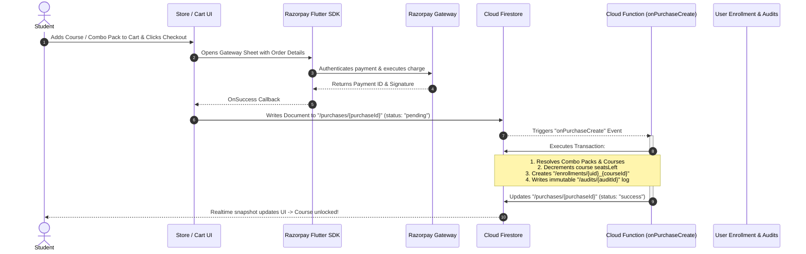
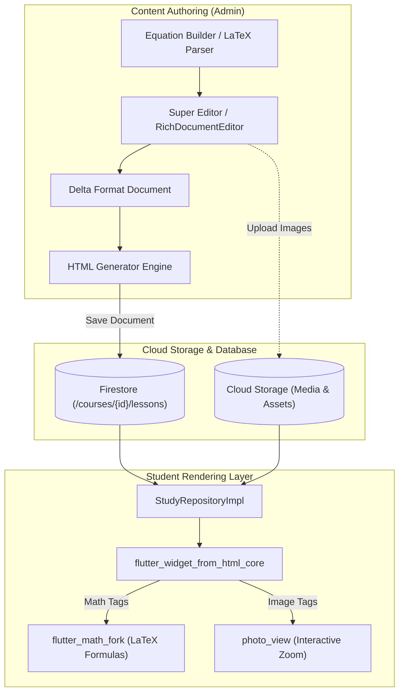
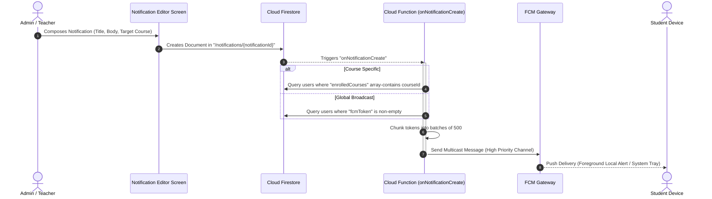
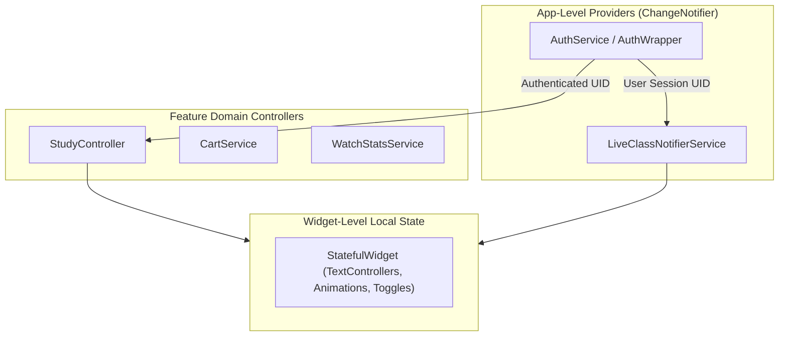
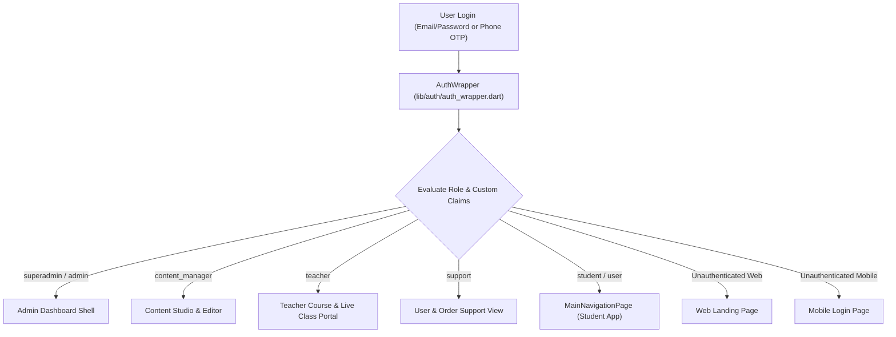
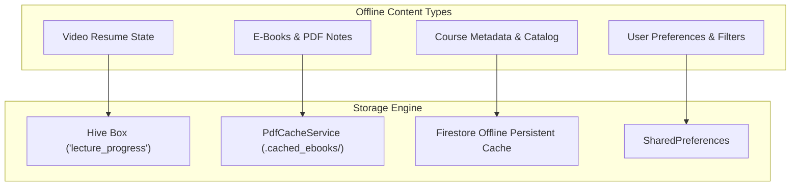
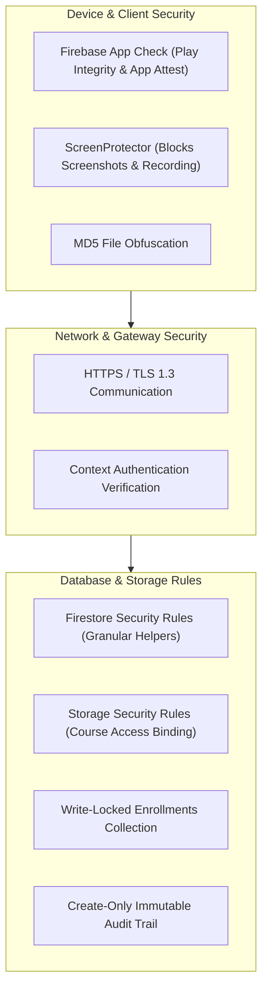

# Eduverse System Architecture

This document provides a comprehensive technical overview of the **Eduverse** educational technology platform. Eduverse is a multi-platform application designed for online learning, course management, live stream classes, mock tests, and digital material distribution.

---

## 1. High-Level Architecture

The Eduverse architecture adopts a modern serverless design leveraging Flutter on the client across multiple form factors, Firebase as the backend-as-a-service (BaaS), Google Cloud Functions for transactional business logic, and third-party services for media streaming and payment processing.



---

## 2. Tech Stack

The platform is constructed with modern tooling, strict type-safety, and modular architecture across all layers:

| Layer / Domain | Technology / Library | Purpose & Implementation Details |
| :--- | :--- | :--- |
| **Frontend Framework** | `Flutter 3.12+` / `Dart` | Cross-platform UI toolkit targeting Android, iOS, Web, and Desktop. |
| **State Management** | `Provider` + `ChangeNotifier` | Reactive state propagation using `LiveClassNotifierService`, `StudyController`, and component notifiers. |
| **Backend & Database** | `Cloud Firestore` | Distributed document database with granular security rules and offline indexing. |
| **Authentication** | `Firebase Auth` | Email/Password, Phone OTP authentication, and custom JWT claims role mapping. |
| **Serverless Backend** | `Cloud Functions (Node.js 20)` | Event-driven triggers (`onPurchaseCreate`, `onNotificationCreate`), admin callables, and cron schedules. |
| **Media Storage** | `Firebase Cloud Storage` | Secure object storage for course media, notes, e-books, banners, and thumbnails. |
| **Push Notifications** | `Firebase Cloud Messaging` (FCM) + `flutter_local_notifications` | Background multicast push delivery paired with foreground local notification alerts. |
| **Presence & Counters** | `Firebase Realtime Database` (RTDB) | Lightweight presence detection and live viewer synchronization. |
| **Payments** | `razorpay_flutter` + Razorpay REST API | In-app checkout gateway on mobile/web paired with server-side refund/verification APIs. |
| **Video Streaming** | `youtube_player_flutter`, `youtube_player_iframe`, `video_player`, `chewie` | YouTube live class and video-on-demand (VOD) playback with cross-platform fallback for Web. |
| **PDF & Documents** | `syncfusion_flutter_pdfviewer`, `flutter_markdown` | Encrypted/obfuscated e-book and notes rendering with copy/print prevention. |
| **Rich Text Engine** | `super_editor`, `flutter_widget_from_html_core`, `flutter_math_fork` | Admin wysiwyg delta/HTML generation, student HTML presentation with LaTeX equation rendering. |
| **Data Visualization** | `fl_chart` | Interactive performance analysis, quiz score trends, and study metrics charts. |
| **Local Storage** | `hive` / `hive_flutter`, `shared_preferences` | High-performance key-value video timestamps (`lecture_progress`) and local app configs. |
| **Networking & HTTP** | `dio`, `cloud_functions`, `firebase_database` | Resilient file download pipelines and HTTPS RPC callable invokers. |
| **Deep Linking** | `app_links` | Multiplatform deep link interception for `/course`, `/batch`, and `/live_class` routes. |
| **Security & Privacy** | `firebase_app_check`, `screen_protector`, `crypto` | Hardware-backed client attestation, screenshot/recording blocking, and file obfuscation. |
| **UI & Experience** | `google_fonts`, `flutter_animate`, `lucide_icons_flutter`, `font_awesome_flutter`, `cached_network_image`, `photo_view`, `carousel_slider` | Polished design system adhering to Material 3 guidelines and fluid transition animations. |

---

## 3. Project Structure

The project is structured by feature domains with distinct separation between administrative controls, core infrastructure, student study areas, and web landing experiences:

```
lib/
├── main.dart                          # App entrypoint, Firebase/Hive bootstrap, route interception
├── admin/                             # Comprehensive Admin & Creator Panel (75 files)
│   ├── models/                        # Data models (AdminCourse, AdminLecture, AdminBatch, etc.)
│   ├── screens/                       # 41 dedicated management screens (Courses, Schedules, Users, Quizzes)
│   ├── services/                      # FirebaseAdminService (121KB), stats, performance services
│   └── widgets/                       # RichDocumentEditor, equation builders, dynamic tables
├── auth/                              # Authentication workflows (7 files)
│   ├── auth_wrapper.dart              # Dynamic role & platform-based dispatch shell
│   ├── login_page.dart                # Mobile/Desktop authentication form
│   └── otp_verification_page.dart     # Phone OTP SMS verification
├── common/                            # Reusable widgets, custom dialogs, app-wide styles (11 files)
├── core/                              # Infrastructure and shared services (34 files)
│   ├── firebase/                      # Auth, Purchase, Cart, Quiz, Watch, Promo services
│   ├── notifications/                 # FCM token synchronization & background receiver service
│   ├── services/                      # Deep links, popups, migrations, PDF cache
│   └── theme/                         # Material 3 colors, typography, and component decorations
├── feed/                              # Social & community announcement feed module (19 files)
├── navigation/                        # Bottom navigation shell (1 file)
├── profile/                           # Student profile, study stats, performance analytics (17 files)
├── settings/                          # User settings and compliance accounts deletion (1 file)
├── store/                             # Marketplace, combination packs, checkout, orders (25 files)
├── study/                             # Core learning & curriculum module (51 files)
│   ├── data/repositories/             # StudyRepositoryImpl, LectureProgressRepo, StudyLocalStorage
│   ├── domain/                        # Entities (StudyBatch, StudyLecture, StudyLiveClass) & interfaces
│   ├── presentation/                  # StudyController, lecture viewer, live streaming screens
│   └── screens/                       # Legacy & specialized sub-screens
├── utils/                             # Test scaffolding and diagnostics (2 files)
└── web/                               # Responsive web landing pages & SEO routing (17 files)

Total: ~262 Dart source files
```

---

## 4. Data Flow Architecture

### 4.1 Purchase & Transactional Enrollment Flow
Purchases are processed securely through client SDK initiation and executed server-side via Cloud Firestore transactional triggers, preventing unauthorized write access to course enrollments.



---

### 4.2 Rich Content Delivery & Rendering
Educational content is drafted in the administrative WYSIWYG editor using structured Delta JSON, exported to sanitized HTML, and rendered in high-fidelity on the student interface with custom widget builders for mathematical equations and code blocks.



---

### 4.3 Notification Distribution Flow
Administrative notifications trigger backend fan-out pipelines that query subscribed or enrolled users and dispatch optimized multicast payloads through Firebase Cloud Messaging.



---

### 4.4 Live Class Scheduling & Streaming Flow
Instructors define recurring schedule rules which automatically populate the student timetable. When live streaming commences, presence and viewer counts are synchronized across Firestore and Realtime Database.

```mermaid
flowchart LR
    subgraph Creator["Teacher / Admin Studio"]
        Rule["Schedule Rules Screen"]
        LiveClass["Live Class Instance"]
        StreamURL["YouTube Live / RTMP Stream ID"]
    end

    subgraph SyncEngine["Synchronization Layer"]
        RuleGenerator["Batch Class Generator"]
        FirestoreLive[("Firestore (/live_classes)")]
        RTDBPresence[("Realtime Database (live_viewers)")]
    end

    subgraph StudentClient["Student App"]
        Notifier["LiveClassNotifierService (Provider)"]
        LivePopup["LiveClassPopup Banner"]
        Player["YouTube Player / Live Stream Screen"]
    end

    Rule --> RuleGenerator
    RuleGenerator --> LiveClass
    StreamURL --> LiveClass
    LiveClass -->|Status: "live"| FirestoreLive

    FirestoreLive -->|Stream Subscription| Notifier
    Notifier -->|State Change| LivePopup
    LivePopup -->|Click Watch| Player
    Player <==>|Heartbeat / onDisconnect| RTDBPresence
```

---

## 5. State Management

Eduverse adopts a clean, reactive state management model driven by `Provider` and `ChangeNotifier`, ensuring separation between global domain state and localized widget UI state.



### 5.1 StudyController
Located at [`lib/study/presentation/providers/study_controller.dart`](file:///home/himanshu/codes/eduverse/lib/study/presentation/providers/study_controller.dart), this controller serves as the primary state hub for the student learning module:
- **Batch & Course Feeds**: Listens to active subscriptions via [`IStudyRepository`](file:///home/himanshu/codes/eduverse/lib/study/domain/repositories/i_study_repository.dart).
- **Navigation & Filtering**: Controls active tabs (`Courses`, `Test Series`, `E-Books`), exam category chips, search filters, and favorite courses.
- **Progress Tracking**: Manages video lecture positions and synchronizes playback intervals directly with local persistence.

### 5.2 LiveClassNotifierService
Located at [`lib/core/services/live_class_notifier_service.dart`](file:///home/himanshu/codes/eduverse/lib/core/services/live_class_notifier_service.dart), this service runs globally above the navigation shell:
- Dynamically discovers all courses the user is actively enrolled in.
- Maintains real-time Firestore listeners for `live_classes` documents where `status == 'live'`.
- Drives the floating `LiveClassPopup` widget without interrupting current user activity.

### 5.3 Screen-Level State
Transient state (such as text editing controllers, animation controllers, dropdown selections, and form validation) is managed locally within standard `StatefulWidget` classes.

---

## 6. Authentication & Authorization

Authentication is built around Firebase Auth with Role-Based Access Control (RBAC) enforced via Firebase Custom Claims and mirrored database attributes.



### Role-Based Access Matrix

| Role | Permissions & Scope |
| :--- | :--- |
| **`superadmin`** | Full root access across database, role assignment, payments, and system configuration. |
| **`admin`** | Manages courses, lessons, users, test series, notifications, and handles refund operations. |
| **`content_manager`** | Creates and publishes lectures, notes, quizzes, and curriculum assets. |
| **`teacher`** | Manages assigned courses, hosts live classes, answers questions, and moderates student comments. |
| **`support`** | View-only permissions on purchases, user profiles, and enrollment audit trails. |
| **`student`** | Standard enrolled student access to purchased curriculum, test series, and comments. |

---

## 7. Offline Strategy

Eduverse incorporates a hybrid offline strategy to maximize playback reliability, protect sensitive digital content, and enable uninterrupted study on weak or intermittent internet connections.



1. **Hive Video Timestamp Box (`lecture_progress`)**:
   - Stores exact playback milestones (seconds watched, total duration, completion percentage).
   - Read synchronously upon video initialization for instant resume without waiting on network queries.
2. **Obfuscated E-Book Cache ([`PdfCacheService`](file:///home/himanshu/codes/eduverse/lib/core/services/pdf_cache_service.dart))**:
   - Downloads encrypted PDF buffers and saves them to a hidden `.cached_ebooks/` application directory.
   - Files are stored using an MD5 hash of their URL (`<md5_hash>.dat`) without `.pdf` extensions, preventing external file browser indexing.
3. **SharedPreferences**:
   - Retains active room IDs, exam filter chips, poster dismissals, and download indices.
4. **Firestore Built-in Offline Persistence**:
   - Enables offline caching for enrolled course structures, notes, and local drafts.

---

## 8. Security Architecture

Eduverse enforces a defense-in-depth security model combining client-side tampering protection, hardware attestation, and strict server-side rule evaluation.



### Key Security Policies
1. **Firebase App Check**:
   - Enforced across mobile and web via `AndroidPlayIntegrityProvider` (Production) / `AppleAppAttestProvider` to block unauthorized API scrapers and automated bots.
2. **Firestore Security Rule Helpers**:
   - `isAdmin()`: Validates token claims and backend document verification for administrative roles.
   - `isEnrolled(courseId)`: Asserts active user enrollment records before allowing lesson or quiz read access.
   - `isTeacher()`: Authorizes instructors to access live class studio controls and student interaction data.
3. **Storage Security Rules**:
   - Storage buckets mirror Firestore permissions; sensitive course resources (`/courses/{courseId}/*`) strictly require `isEnrolled(courseId)` or `isAdmin()`.
4. **Screenshot & Data Leakage Protection**:
   - Managed automatically via [`screen_protector`](file:///home/himanshu/codes/eduverse/lib/auth/auth_wrapper.dart#L28-L61). Screenshot capture and background app thumbnail generation are blocked for non-admin student sessions viewing premium coursework.
5. **Locked Enrollments & Immutable Purchases**:
   - Direct client writes to `/enrollments/*` are strictly blocked (`allow write: if false;`). Enrollments can only be created by verified Cloud Function transactions.
   - Transaction records in `/purchases/*` are create-only for authenticated students, preventing modification or deletion after payment submission.
